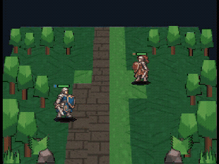
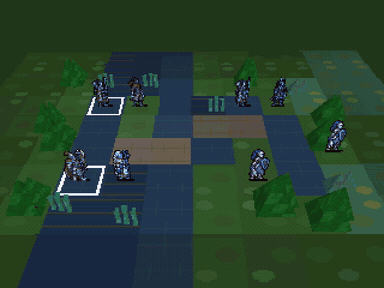

<p align="center">
  
</p>

# Grandleon

Grandleon is a tool for making and playing tactical role-playing games. Its
Godot application includes both the campaign creator and the PC player. The
same project can also be built for Nintendo 64 and PlayStation without changing
its rules.


This is the current **Steel and Cedar** demo in Godot. Rowan crosses Bell
Orchard, attacks a swordsman, takes a counterattack and returns to the board.
The recording uses the running player and the campaign’s actual rules.

## Make a game

Open Grandleon, choose **Create / Edit Games**, then **New Campaign**. Enter a
name and choose **Create & Open First Map**. The new campaign starts playable:
it already has two heroes, opponents, a goal, a conversation, local co-op
ownership, and an ending.


From there you can:

- paint and resize maps;
- place characters and divide allies between two local players;
- write story scenes and in-battle conversations;
- create roles, factions, weapons, items, abilities, and rewards;
- define objectives and branching outcomes;
- test the current draft immediately; and
- export an editable project or a player-only game.

The creator is designed around ordinary game-making tasks rather than source
files or internal identifiers. [Creating a game](docs/CREATING_A_GAME.md) is a
short visual tour of the current workflow; the full tutorial is planned once
the editor settles closer to 1.0.

## Play Steel and Cedar

The included demo is **Steel and Cedar**, a five-battle campaign shared by
Godot, Nintendo 64, and PlayStation. A false treaty signal draws two realms
toward war; follow its couriers from an orchard through woodland and village
streets to the hidden throne room of Twin Gate Keep.

Choose **1 Player** or **2 Players** before starting. Solo follows Rowan and
Tomas; local co-op adds Akari and Ren with their own controller, routes,
formations, and opposition. The two variants share a story but give the
players distinct tactical openings. The campaign includes a twenty-round
signal defense and a castle whose interior is revealed as your party enters.

The demo has authored English, Spanish, and Brazilian Portuguese text. Choose
a language before play or change it in Settings. Games offer a language choice
only when their package contains translations. Missing or outdated lines use
the current source text.

Use the demo mainly as a feature and translation test for now. A polished,
fully designed campaign is planned before 1.0.

The editable project is in [games/steel_and_cedar](games/steel_and_cedar).
Earlier campaigns remain in `games/` as examples and regression fixtures.

## The Godot presentation

Godot is the main player and creator. Its supported presentation combines
authored 3D terrain with animated high-resolution 2D characters.


The current Godot art pack covers all eight character archetypes and all
thirteen terrain kinds. Its seven directions are sci-fi, mythical, medieval,
nature, Sengoku, Undead, and Pirates. Each has male and female designs for every
archetype. Either body can wear any of the six faction colours without
recolouring faces, hair, equipment, or effects. A separate lower-resolution
pixel library supplies shared previews and interface art; console exports
require the curated sheets shown here.


This is a quick sample rather than the whole catalog. See the
[artwork and animation roster](docs/ARTWORK.md) for animated previews and exact
coverage.

The screenshot above is an earlier sample; the artwork sampler remains a guide
to the available character catalog.

Boards larger than the readable view scroll horizontally and vertically on
Godot, Nintendo 64, and PlayStation. Small maps stay centered; on large maps,
the camera follows the active cursor without shrinking characters into
unreadable tokens.

Godot can also switch from the board to an optional terrain-derived close view
for an attack, its reported damage or miss, any legal counterattack, and a
defeat. Area abilities keep the acting character in place while each target
enters the other side of the scene; healing another character, endurance, and
item drops use the same accepted battle results. The session menu can disable
these **Battle Close-ups**. Hold Confirm to fast-forward a close-up or press
Cancel to skip it; either choice returns to the authoritative board state that
the shared engine already accepted.
Godot’s live board remains visible as the camera focuses the two units and pushes
into the close view, then the result dissolves back to that settled board.
Compatible terrain now selects a layered background that remains stable for
the complete exchange. The current library covers forest scenes plus the
Medieval village and castle used by **Steel and Cedar**. Village and castle
art requires the exact authored map and nearby landmark, so another paved map
cannot receive it by accident. In-battle conversations use the same background
pool, anchored to the speaking character, while unsupported terrain keeps a
simple readable fallback behind the portrait and dialogue.
The in-game Settings menu can also show a small live FPS counter on any
renderer. It is off by default, including in console ROMs and disc images.

Across all three players, entering Steel and Cedar’s keep reveals its hidden
interior while preserving the authored tactical rules.

The players share an orchestral soundtrack and distinct weapon, magic and
healing effects. Adjust **Music** and **Sound Effects** separately in Settings; each volume is saved. Creator support for importing
your own audio is planned on the roadmap below.

## One project, several targets

Make one project and play it on PC, Nintendo 64 or PlayStation. Each player
uses the same maps, units and battle rules.

| Nintendo 64 | PlayStation |
| --- | --- |
|  |  |

The Godot recording above and both console clips show the same one-player
**Steel and Cedar** opening, with the same map, units and move. Rowan attacks
the swordsman beside the orchard gate, receives a counterattack, then returns
to the board. Each recording preserves the player’s actual timing.

The installed Export Center can produce:

- a portable `.grandleon.zip` project;
- a standalone Linux PC game;
- a Nintendo 64 `.z64` ROM when its optional builder is installed; and
- a PlayStation `.bin`/`.cue` pair when its optional builder is installed.

Console builders are separate downloads because their pinned toolchains are
large. They work offline after installation. The PlayStation image has no Sony
licence sector and therefore does not boot on an unmodified retail console.
Console exports use the curated character artwork shown above, adapted to each
machine. Both consoles target 30 fps.

Nintendo 64 now uses Pyrite/Tiny3D and PlayStation uses Mipsync. This release
is part of that transition: the players share Godot’s campaign features while
console graphics continue to mature.

PS1 camera movement can still judder on larger maps, especially around the
castle. Smoother frame pacing remains planned after 0.5; it does not block
this release's functional-parity review.

`games/sevenfold` remains the older compact art showcase campaign. One ROM asks for one or
two players on its main menu, fields every archetype across all seven art
styles, and uses seven different maps covering every terrain kind. A debug
Stage-picker build can jump directly between the gates for review.

See the [0.5 release notes](release/0.5.0/README.md) for the current demo,
launch guidance, and known limitations. The committed
[0.4 review builds](release/0.4.0/README.md) remain an older Sevenfold Gate
snapshot. [Playing on Nintendo 64 and PlayStation](docs/CONSOLE_RENDERER.md)
covers controls, exports, and development builds.

## Roadmap

The roadmap is intentionally short. Completed versions are milestones; the
rest of the documentation describes the current Godot application.

| Version | Focus |
|---|---|
| **0.1** | Portable foundation. Established readable project source, deterministic tactical rules, an early creator, and working terminal and console presentations. |
| **0.2** | Complete campaign runtime. Added richer campaign play, in-battle dialogue, progression and inventory, weapon relationships, larger scrolling boards, console export work, and cross-target conformance for the shipped campaigns. |
| **0.3** | Godot player and creator. Moved the supported PC experience to Godot, joined creation and play in one application, and added local co-op, standalone export, authored 3D terrain, and a complete high-resolution sci-fi archetype roster. |
| **0.4** | Broader art and console campaigns. Completes seven coherent Godot character directions, improves terrain clusters and movement presentation, adds portable one/two/choice campaign launch policy, streamlines the player around a nearly full-screen board, includes distinct solo and local co-op campaigns, and uses one textured renderer for the PlayStation and Nintendo 64 campaigns. It also introduces the first optional terrain-aware Godot combat close-up. |
| **0.5** | Editor, translations and console play. Improves campaign creation, previews and project checks, including a test that creates, exports and plays a new game. Adds manual translations, player-named characters, orchestral music and distinct combat sounds. Introduces Steel and Cedar and moves the console players to Pyrite/Tiny3D and Mipsync. |
| **Prior to 1.0** | Design and playtest a polished campaign with a cohesive story, introductory battles, distinct solo/co-op tactics, varied maps and a final boss. Improve console graphics, animation, UI and performance. Expand combat and conversation backdrops with optional ambient motion. Rework audio and let creators import and assign their own music and effects. Experiment with Android and possibly iOS exports of the Godot player and creator. |

See [TODO](TODO.md) for the detailed work list.

Importing external artwork may be explored later, but it is not part of the
current roadmap commitment.

Localization is manual and usable today. The application menus and creator
are available in English, Spanish, and Brazilian Portuguese. Choose a language
on the home or project screen; it applies immediately and is remembered.

A game records its own source language and translations in the portable
project. In **Translations**, review player-facing text and character names,
filter missing or outdated entries, and exchange **.PO** catalogs with a
translator. **Play Language** previews the selected campaign and 1P/2P variant
without touching a real save. Authored translations travel with exports to all
three players. Changed source text falls back to the current original until
its translation is reviewed again.

To contribute a menu language, follow [TRANSLATING.md](TRANSLATING.md): copy
the English catalog, keep its IDs and placeholders, translate the values, and
submit a pull request. Translating a game uses that project’s catalog instead.
An external translation service is not required; optional suggestions may be
explored later, with author review retained.

Player-chosen character names remain literal player input rather than
translation material; in Godot they survive save and continue and can appear
in dialogue, objectives, rosters, and exact on-board unit labels. Nintendo 64
and PlayStation now offer the same compact controller keyboard when an author
allows a name to be changed. It has an 18-character console limit, keeps fixed
names fixed, saves the choice with the campaign, and does not ask again on
Continue. Explicit member references in console dialogue and objectives use
the player's literal choice after the surrounding authored text is localized.

The concrete presentation experiments currently in progress are kept in the
short [development TODO](TODO.md).

## Build and run from source

To build the same self-contained Linux application used by players and authors:

```sh
platform/godot/scripts/build-steamos.sh --output out/grandleon-pc
GRANDLEON_WINDOWED=1 out/grandleon-pc/launch-pc.sh
```

To build only the shared native engine and package tools:

```sh
cmake -S . -B build -DGRANDLEON_BUILD_TESTS=OFF
cmake --build build
./build/grandleon_content_compile \
  games/steel_and_cedar/source/project.json build/steel-and-cedar.gpk
./build/grandleon_package_check build/steel-and-cedar.gpk
```

Developer setup, test dependencies, and console commands are in
[Setting up](docs/SETUP.md). Architecture and contribution guidance are in
[CODING.md](CODING.md) and [CONTRIBUTING.md](CONTRIBUTING.md).

## Project files

- `project.json` is the readable authoring source.
- `.grandleon.zip` is the portable editable project archive.
- `.gpk` is the compiled package consumed by runtimes.

Projects, saves, controls, recovery data, and exports live in per-user runtime
storage. Portable archives do not contain usernames, machine paths,
credentials, controller identities, or local settings.

Projects exported by earlier Grandleon releases can be imported from the Godot
Projects screen. When a stored project needs a schema update, its card explains
the update before anything changes. Opening it keeps the original readable
source under that project's recovery data, performs the update, and reports
the result. An unreadable source is left untouched instead of being replaced.
Portable project assets transfer; local recovery data and playtest progress do
not.

> **Back up projects while the editor evolves.** We still plan to do heavy work
> on the editor throughout the next releases, and we will update the schema
> version with those changes. Existing projects should import through the
> migration path, but until the editor reaches a stable format they may need
> occasional adjustments. Back up your game at multiple stages before
> upgrading, and report any import or migration issue you find.

## Documentation

| I want to… | Read |
|---|---|
| make a campaign | [Creating a game](docs/CREATING_A_GAME.md) |
| inspect characters, animation, and terrain | [Artwork and animation roster](docs/ARTWORK.md) |
| tweak or regenerate a character | [Artwork generation and tweak guide](docs/ARTWORK_GENERATION.md) |
| play or export on a console | [Nintendo 64 and PlayStation](docs/CONSOLE_RENDERER.md) |
| submit a translation | [Translation contribution guide](TRANSLATING.md) |
| build or contribute | [Setting up](docs/SETUP.md) and [Contributing](CONTRIBUTING.md) |

## Licence

Grandleon is released under the [MIT License](LICENSE). Bundled dependencies
retain their own licences and notices.

## Author

Luis Felipe Strano Moraes, luis.strano at gmail dot com
