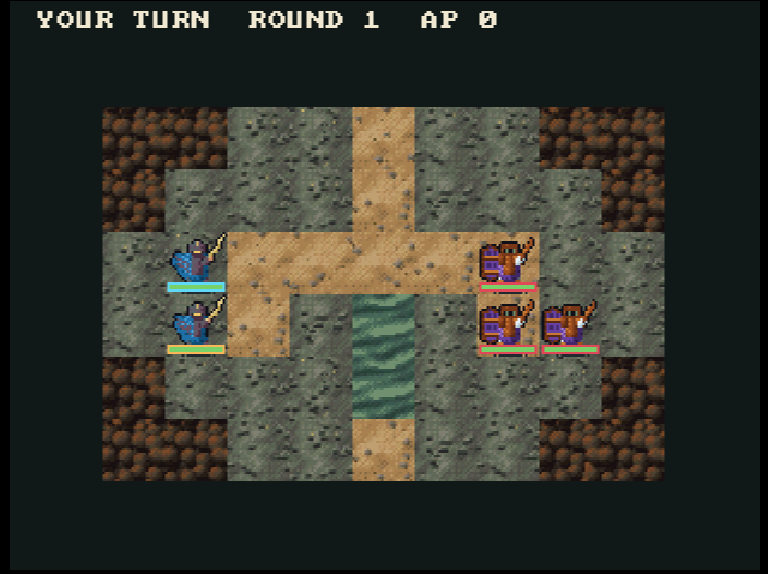
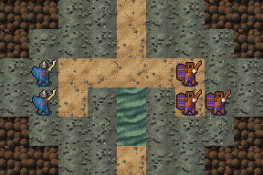

<p align="center">
  
</p>

# Grandleon

Grandleon is a tool for making and playing tactical role-playing games. Its
Godot application includes both the campaign creator and the PC player. The
same project can also be built for Nintendo 64 and PlayStation without changing
its rules.


The animation above is captured from the included sample campaign in the running
Godot client. It follows the party into close combat and includes the live
movement, attack, hit, and impact animations—not a mockup or concept render.

## Make a game

Open Grandleon, choose **Create / Edit Games**, then **New Campaign**. Enter a
name and choose **Create & Open First Map**. The new campaign starts playable:
it already has two heroes, opponents, a goal, a conversation, local co-op
ownership, and an ending.


From there you can:

- paint and resize maps;
- place characters and divide allies between two local players;
- write story scenes and in-battle conversations;
- create roles, factions, weapons, items, abilities, and rewards;
- define objectives and branching outcomes;
- test the current draft immediately; and
- export an editable project or a player-only game.

The creator is designed around ordinary game-making tasks rather than source
files or internal identifiers. [Creating a game](docs/CREATING_A_GAME.md) walks
through the complete workflow with screenshots from the real application.

## Play the included campaigns

The home screen includes two complete examples with their intended player
counts shown before launch:

- **The Tarnholt Line — one player.** The earlier six-battle campaign is a
  longer solo test of branching story, recruitment, deployment, survival
  goals, and a final boss.
- **Emberbound: The Last Dawn — two players.** The current five-battle local
  co-op campaign divides one allied company between two independent controls.

These are separate compiled games, not two labels for the same package. They
also remain portable projects under `games/tarnholt` and `games/emberbound`, so
the engine and console tests exercise the same authored source as the PC
examples.

## The Godot presentation

Godot is the main player and creator. Its supported presentation combines
authored 3D terrain with animated high-resolution 2D characters.


The current Godot art pack covers all eight character archetypes and all
thirteen terrain kinds. All seven directions—sci-fi, mythical, medieval,
nature, Sengoku, Undead, and Pirates—have male and female designs for every
archetype. Either body can wear any of the six faction colours without
recolouring faces, hair, equipment, or effects. The generated portable library
also remains available as a fallback for every archetype across all seven
styles, six faction colours, and two bodies. See the
[artwork and animation roster](docs/ARTWORK.md) for animated previews and exact
coverage.

## One project, several targets

Portable project source is compiled into the same deterministic rules on each
target. Rendering and controls differ, but movement, combat, objectives,
campaign state, and random results remain authoritative in the shared engine.

| Nintendo 64 | PlayStation |
|---|---|
|  |  |

The installed Export Center can produce:

- a portable `.grandleon.zip` project;
- a standalone Linux PC game;
- a Nintendo 64 `.z64` ROM when its optional builder is installed; and
- a PlayStation `.bin`/`.cue` pair when its optional builder is installed.

Console builders are separate downloads because their pinned toolchains are
large. They work offline after installation. The PlayStation image has no Sony
licence sector and therefore does not boot on an unmodified retail console.

0.4 also includes a separate, fixed **N64 3D character prototype ROM** for
comparing the newer Godot commander and rogue models at board, tactical, and
action distances. It is not an editor export or a playable campaign. The N64
comparison clears its 30 fps target; the PlayStation comparison does not at a
full sixteen-unit board, so PlayStation keeps its supported sprite renderer.
[See the captures, measurements, and build command](docs/CONSOLE_3D_EXPERIMENT.md).

[From the editor to a console](docs/FROM_EDITOR_TO_CONSOLE.md) explains how one
authored choice travels through the compiler, shared engine, and each renderer.

## Roadmap

The roadmap is intentionally short. Completed versions are milestones; the
rest of the documentation describes the current Godot application.

| Version | Focus |
|---|---|
| **0.1 — portable foundation** | Established readable project source, deterministic tactical rules, browser authoring, and working terminal, Nintendo 64, PlayStation, and web presentations. |
| **0.2 — complete campaign runtime** | Added richer campaign play, in-battle dialogue, progression and inventory, weapon relationships, larger scrolling boards, console export work, and cross-target conformance for the shipped campaigns. |
| **0.3 — Godot player and creator** | Moved the supported PC experience to Godot, joined creation and play in one application, and added local co-op, standalone export, authored 3D terrain, and a complete high-resolution sci-fi archetype roster. |
| **0.4 — broader art and console 3D experiments** | Completes seven coherent Godot character directions, improves terrain clusters and movement presentation, includes distinct solo and local co-op campaigns, and records a bounded low-detail 3D comparison on PlayStation and Nintendo 64. This is the current development line. |
| **0.5 — editor product pass** | Concentrates on the complete authoring experience: clearer workflows, stronger previews, better project organization, and the usability and accessibility work needed for larger games. |
| **0.6 — cinematic battles** | Adds an optional terrain-aware close-up attack view with counter-attacks and damage numbers, while retaining the faster board-only presentation as a game setting. |

Importing external artwork may be explored later, but it is not part of the
current roadmap commitment.

The concrete presentation experiments currently in progress are kept in the
short [development TODO](TODO.md).

## Build and run from source

To build the same self-contained Linux application used by players and authors:

```sh
platform/godot/scripts/build-steamos.sh --output out/grandleon-pc
GRANDLEON_WINDOWED=1 out/grandleon-pc/launch-pc.sh
```

To build only the shared native engine and package tools:

```sh
cmake -S . -B build -DGRANDLEON_BUILD_TESTS=OFF
cmake --build build
./build/grandleon_content_compile \
  games/emberbound/source/project.json build/emberbound.gpk
./build/grandleon_package_check build/emberbound.gpk
```

Developer setup, test dependencies, and console commands are in
[Setting up](docs/SETUP.md). Architecture and contribution guidance are in
[CODING.md](CODING.md) and [CONTRIBUTING.md](CONTRIBUTING.md).

## Project files

- `project.json` is the readable authoring source.
- `.grandleon.zip` is the portable editable project archive.
- `.gpk` is the compiled package consumed by runtimes.

Projects, saves, controls, recovery data, and exports live in per-user runtime
storage. Portable archives do not contain usernames, machine paths,
credentials, controller identities, or local settings.

Projects exported by Grandleon 0.2 remain compatible with 0.3. Export a
`.grandleon.zip` from the browser editor and import it from the Godot Projects
screen. Authored source and project assets transfer; browser-local recovery data
and playtest progress do not.

> **Back up projects while the editor evolves.** We still plan to do heavy work
> on the editor throughout the next releases, and we will update the schema
> version with those changes. Existing projects should import through the
> migration path, but until the editor reaches a stable format they may need
> occasional adjustments. Back up your game at multiple stages before
> upgrading, and report any import or migration issue you find.

## Documentation

| I want to… | Read |
|---|---|
| make a campaign | [Creating a game](docs/CREATING_A_GAME.md) |
| inspect characters, animation, and terrain | [Artwork and animation roster](docs/ARTWORK.md) |
| see current presentation experiments | [Development TODO](TODO.md) |
| understand the Godot player and creator | [Godot PC application](platform/godot/README.md) |
| understand portability and console builds | [From the editor to a console](docs/FROM_EDITOR_TO_CONSOLE.md) |
| review the console 3D experiment | [Console 3D experiment](docs/CONSOLE_3D_EXPERIMENT.md) |
| set up a development checkout | [Setting up](docs/SETUP.md) |
| work on the engine | [CODING.md](CODING.md) and [DESIGN.md](DESIGN.md) |
| contribute | [CONTRIBUTING.md](CONTRIBUTING.md) |

## Licence

Grandleon is released under the [MIT License](LICENSE). Bundled dependencies
retain their own licences and notices.

## Author

Luis Felipe Strano Moraes — luis.strano at gmail dot com
