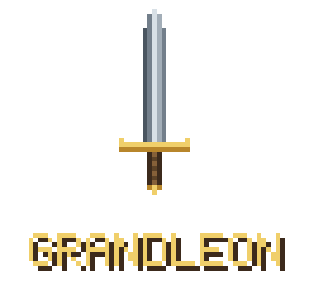
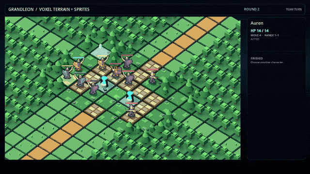
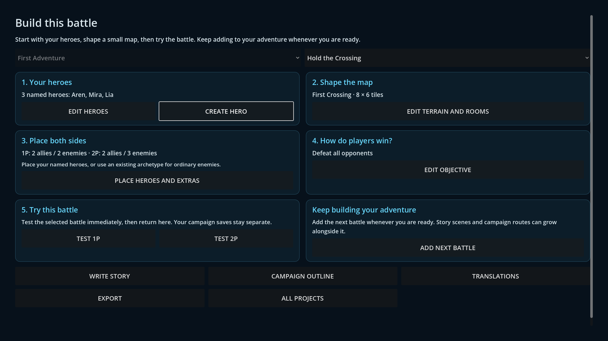
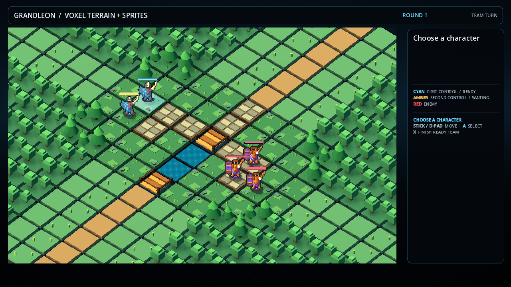
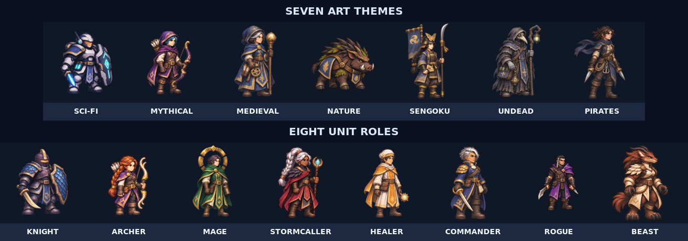
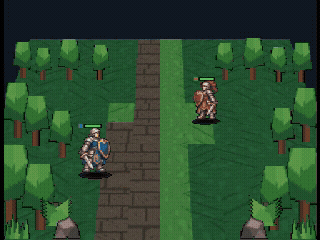
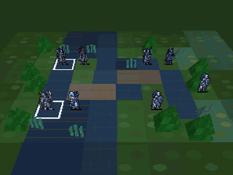

<p align="center">
  
</p>

# Grandleon

Grandleon is a tool for making and playing tactical role-playing games. Its
Godot application includes a campaign creator and player for PC and Android.
The same campaign can also be built for Nintendo 64 and PlayStation.



This is the current **Steel and Cedar** demo in Godot. Rowan crosses Bell
Orchard, attacks a swordsman, takes a counterattack and returns to the board.
The recording uses the running player and the campaign’s actual rules.

[Downloads](https://github.com/lfelipe/grandleon/releases) · [What’s new in 0.6](release/0.6.0/README.md)

## Make a game

Open Grandleon, choose **Create / Edit Games**, then **New Campaign**. Enter a
name, then follow the **Battle Guide**: create your heroes, shape a small map,
place both sides, choose a goal and play it. The starter already works, so you
can test changes immediately and add the next battle when ready. Ordinary
enemies reuse archetypes instead of needing their own main-roster characters.



From there you can:

- create named heroes and choose their appearance and starting role;
- paint and resize maps, place complete landmarks and reveal castle rooms;
- place heroes and archetype-based enemies, with distinct solo/co-op setups;
- write story scenes and in-battle conversations;
- create roles, factions, weapons, items, abilities, and rewards;
- define objectives and branching outcomes;
- test the current draft immediately; and
- export an editable project or a player-only game.

The creator is designed around ordinary game-making tasks rather than source
files or internal identifiers. [Creating a game](docs/CREATING_A_GAME.md) is a
short visual tour of the current workflow; the full tutorial is planned once
the editor settles closer to 1.0.

## Play Steel and Cedar

The included demo is **Steel and Cedar**, with five main battles and two
optional detours on PC, Android, Nintendo 64 and PlayStation. A false treaty signal draws two realms
toward war; follow its couriers from an orchard through woodland and village
streets to the hidden throne room of Twin Gate Keep.

Choose **1 Player** or **2 Players** before starting. Solo follows Rowan and
Tomas; local co-op adds Akari and Ren with their own controller, routes,
formations, and opposition. The two variants share a story but give the
players distinct tactical openings. The campaign includes a twenty-round
signal defense and a castle whose interior is revealed as your party enters.
Look for a hidden find near the orchard bell and approach the Cedar courier
to discover two optional battles. The game shows a summary after a victory
or a campaign-ending defeat.

The demo has authored English, Spanish, and Brazilian Portuguese text. Choose
a language before play or change it in Settings. Games offer a language choice
only when their package contains translations. Missing or outdated lines use
the current source text.

Use the demo mainly as a feature and translation test for now. A polished,
fully designed campaign is planned before 1.0.

The editable project is in [games/steel_and_cedar](games/steel_and_cedar).
Earlier campaigns remain in `games/` as examples and regression fixtures.

## Art and battle presentation



Animated characters move across sculpted terrain, from orchards and villages
to castle interiors. Choose from seven visual themes, eight unit roles, male
and female variants, and six faction colours. The Map Editor includes houses
for every theme and landmarks such as gates, bridges and castle walls.



See the [artwork and animation roster](docs/ARTWORK.md) for more examples.

An opening camera sweep shows the battlefield. Press **Confirm** or tap to
skip it. Attacks can play as close-ups, with a moving camera in Godot and
terrain-matched backdrops. Choose **Battle Close-ups** in Settings to turn
them off. **Music** and **Sound Effects** have separate saved volume controls.

## One project, several targets

Make one project and play it on PC, Nintendo 64 or PlayStation. Each player
uses the same maps, units and battle rules.

| Nintendo 64 | PlayStation |
| --- | --- |
|  |  |

The Godot recording above and both console clips show the same one-player
**Steel and Cedar** opening, with the same map, units and move. Rowan attacks
the swordsman beside the orchard gate, receives a counterattack, then returns
to the board. Each recording preserves the player’s actual timing.

Open **Finish & Export** to share an editable project, a portable campaign,
or a standalone PC game. The optional desktop builders produce a Nintendo 64
ROM or a PlayStation disc image. PlayStation users need a compatible setup
because the disc has no Sony licence sector.

The consoles share the campaign, including co-op, shops and hidden castle
rooms. Both target 30 FPS. PlayStation can still slow down when scrolling on
large, dense boards. [Console controls and exports](docs/CONSOLE_RENDERER.md)

## Co-op, downloadable campaigns and languages

- **Play together on a local network.** Choose **Host on LAN** on PC or
  Android. On the second device, choose **Join a LAN game**. The host keeps
  the campaign save, including progress in the current battle.
- **Find more games.** **Browse Campaigns** downloads games from the
  [public catalogue](https://github.com/lfelipe/grandleon-campaigns) or a
  catalogue you add. Installed campaigns work offline. For an incompatible
  update, you can keep the installed version and its saves.
- **Play or create on Android.** Touch controls adapt to phones and tablets.
  Share editable projects or portable campaigns from Android and open them
  on a PC to build a console version.
- **Translate a game.** Grandleon includes English, Spanish and Brazilian
  Portuguese menus. Use **Translations** and **Play Language** to edit and
  preview your campaign’s own text. [Contribute a menu translation](TRANSLATING.md)

## Roadmap

| Version | Focus |
|---|---|
| **0.1** | Portable foundation. Established readable project source, deterministic tactical rules, an early creator, and working terminal and console presentations. |
| **0.2** | Complete campaign runtime. Added richer campaign play, in-battle dialogue, progression and inventory, weapon relationships, larger scrolling boards, console export work, and cross-target conformance for the shipped campaigns. |
| **0.3** | Godot player and creator. Moved the supported PC experience to Godot, joined creation and play in one application, and added local co-op, standalone export, authored 3D terrain, and a complete high-resolution sci-fi archetype roster. |
| **0.4** | Broader art and console campaigns. Completes seven coherent Godot character directions, improves terrain clusters and movement presentation, adds portable one/two/choice campaign launch policy, streamlines the player around a nearly full-screen board, includes distinct solo and local co-op campaigns, and uses one textured renderer for the PlayStation and Nintendo 64 campaigns. It also introduces the first optional terrain-aware Godot combat close-up. |
| **0.5** | Editor, translations and console play. Improves campaign creation, previews and project checks, including a test that creates, exports and plays a new game. Adds manual translations, player-named characters, orchestral music and distinct combat sounds. Introduces Steel and Cedar and moves the console players to Pyrite/Tiny3D and Mipsync. |
| **0.6** | Windows and Android creator/player builds, LAN co-op and downloadable campaigns. A simpler, heroes-first editor workflow, configurable enemy loot, personal packs, before-battle shops and larger explorable castle rooms. Richer scenery and console graphics, with a 30 FPS target. |
| **0.7** | Enemy threat previews, painted map objectives and events, optional battle retries and scouting, and clearer initiative order. |
| **Prior to 1.0** | Design and playtest a polished campaign with a cohesive story, introductory battles, distinct solo/co-op tactics, varied maps and a final boss. Expand shop interactions and rewards from maps and battles. Rework audio and let creators import and assign their own music and effects. Experiment with iOS exports of the Godot player and creator. Publish approachable tutorials for creating and sharing games. |
| **After 1.0** | Explore weapon wear from use and blacksmiths who can repair worn weapons. |

See [TODO](TODO.md) for the detailed work list.

## Build and run from source

To build the same self-contained Linux application used by players and authors:

```sh
platform/godot/scripts/build-steamos.sh --output out/grandleon-pc
GRANDLEON_WINDOWED=1 out/grandleon-pc/launch-pc.sh
```

To build only the shared native engine and package tools:

```sh
cmake -S . -B build -DGRANDLEON_BUILD_TESTS=OFF
cmake --build build
./build/grandleon_content_compile \
  games/steel_and_cedar/source/project.json build/steel-and-cedar.gpk
./build/grandleon_package_check build/steel-and-cedar.gpk
```

Developer setup, test dependencies, and console commands are in
[Setting up](docs/SETUP.md). Architecture and contribution guidance are in
[CODING.md](CODING.md) and [CONTRIBUTING.md](CONTRIBUTING.md).

## Project files

- `project.json` is the readable authoring source.
- `.grandleon.zip` is the portable editable project archive.
- `.gpk` is the compiled package consumed by runtimes.

Projects, saves, controls, recovery data, and exports live in per-user runtime
storage. Portable archives do not contain usernames, machine paths,
credentials, controller identities, or local settings.

Projects exported by earlier Grandleon releases can be imported from the Godot
Projects screen. When a stored project needs a schema update, its card explains
the update before anything changes. Opening it keeps the original readable
source under that project's recovery data, performs the update, and reports
the result. An unreadable source is left untouched instead of being replaced.
Portable project assets transfer; local recovery data and playtest progress do
not.

> **Back up projects while the editor evolves.** We still plan to do heavy work
> on the editor throughout the next releases, and we will update the schema
> version with those changes. Existing projects should import through the
> migration path, but until the editor reaches a stable format they may need
> occasional adjustments. Back up your game at multiple stages before
> upgrading, and report any import or migration issue you find.

## Documentation

| I want to… | Read |
|---|---|
| make a campaign | [Creating a game](docs/CREATING_A_GAME.md) |
| inspect characters, animation, and terrain | [Artwork and animation roster](docs/ARTWORK.md) |
| tweak or regenerate a character | [Artwork generation and tweak guide](docs/ARTWORK_GENERATION.md) |
| play or export on a console | [Nintendo 64 and PlayStation](docs/CONSOLE_RENDERER.md) |
| submit a translation | [Translation contribution guide](TRANSLATING.md) |
| build or contribute | [Setting up](docs/SETUP.md) and [Contributing](CONTRIBUTING.md) |

## Licence

Grandleon is released under the [MIT License](LICENSE). Bundled dependencies
retain their own licences and notices.

## Author

Luis Felipe Strano Moraes, luis.strano at gmail dot com
