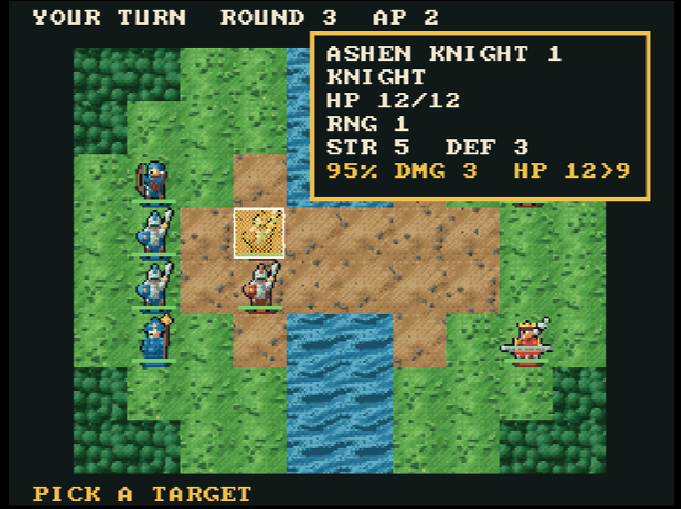
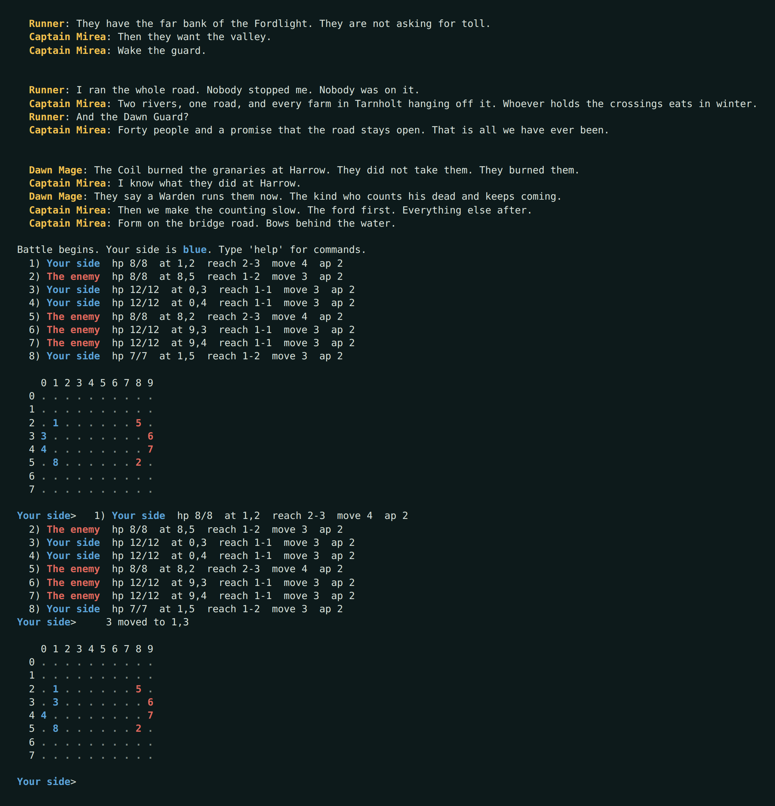
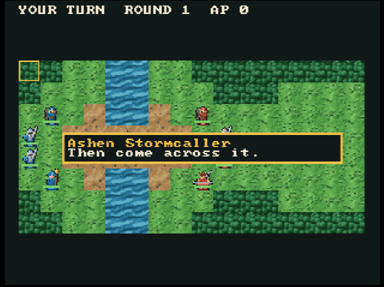

<p align="center">
  
</p>

# Grandleon - Tactical RPG Engine

Grandleon is a tool for making tactical role-playing games, and a portable
engine for playing them.

You draw maps, make characters, give them weapons, abilities and items, decide
what winning means, and connect battles and conversations into a campaign. The
Godot PC application is both the supported player and the campaign creator.
Projects remain local and portable; PC, Nintendo 64, and PlayStation consume
the same authored rules.

## Make a game

Launch the installed PC application, choose **Create / Edit Games**, then **New
Campaign**. Give the adventure a name and **Create & Open First Map** starts
from a complete playable campaign rather than an empty schema.


From a source checkout, build and launch the same portable Linux application:

```sh
platform/godot/scripts/build-steamos.sh --output out/grandleon-pc
GRANDLEON_WINDOWED=1 out/grandleon-pc/launch-pc.sh
```

The starter includes two heroes, enemies, a goal, a conversation, co-op
ownership and scaling, and an ending. Shape the map, write the story, then use
**Test Campaign**. **Continue Creating** opens the readable campaign outline;
**Add Next Chapter** copies a known-working battle into a fresh map and story,
while **Outcomes** adds existing destinations, alternate playable chapters, or
named endings only when the campaign needs them. Stick or d-pad, Confirm, and
Cancel cover the complete flow; a keyboard enters names and dialogue.

Projects live in per-user runtime storage, never in the installation. Import
and export use `.grandleon.zip` archives containing portable source and
project-owned assets only. Machine paths, controls, saves, credentials, and
local settings do not enter the archive.

When the campaign is ready, **Finish & Export** keeps the choices simple:

- **Portable Project** makes the editable `.grandleon.zip` you can move to
  another Grand Leon installation.
- **Linux PC** makes a standalone player-only game when the verified player
  shell is installed.
- **Nintendo 64** and **PlayStation** appear independently when their optional
  builder downloads are installed. They build in the background and produce a
  `.z64` ROM or a `.bin`/`.cue` disc pair. The installed builders work offline
  and do not ask an author to install Docker, clone this repository, or expose
  a home directory to the build.

The console builders have passed their license-archive, golden-output, and
emulator acceptance gates for the 0.3 candidate. They remain disabled in an
installation that does not include the matching release payload; PC and
portable-project export continue to work normally.

[docs/CREATING_A_GAME.md](docs/CREATING_A_GAME.md) walks the whole job in
screenshots captured from the real native creator.

## One game, every screen

One authored game compiles into the same deterministic rules on PC, Nintendo
64, PlayStation, the web runtime, and the terminal reference client.



| Native map creator | Terminal reference client |
|---|---|
|  |  |
| **Nintendo 64** | **PlayStation** |
|  |  |

A character can speak while the battle is on, over the board rather than on a
page of its own, beside whoever is talking:



No interface image above is concept art. Native creator screens come from
`platform/godot/scripts/capture-creator-guide.sh`; running-client and console
imagery comes from the executable checks themselves.

[docs/screenshots/README.md](docs/screenshots/README.md) has the rest of the
pictures, including a whole turn played by the test that checks it.
[docs/FROM_EDITOR_TO_CONSOLE.md](docs/FROM_EDITOR_TO_CONSOLE.md) describes the
path from a choice made in the editor to a pixel on a console, and what each
layer of verification proves.

## What a game is made of

Everything you author is grouped by what you are trying to do: **Projects**,
the **Campaign Outline**, **Map Creator**, **Story**, **Grow the Army**, **Gear
& Abilities**, and **Finish & Export**. Optional details stay behind focused
actions instead of living on one permanent form. Underneath those screens sit
the portable maps, roles, characters, sides, weapon and item families, weapons,
items, abilities, objectives, campaigns, and scenes.

- A **map** is a grid of terrain. Every cell is open ground, water, or heights,
  and a character crosses water or heights only if it is the sort of character
  that can. A flier crosses everything. A cell it may enter still charges it:
  ordinary ground, or heavy going at twice the price.
- A **character** has health, strength, magic, defence, resistance, speed,
  skill, luck, evasion, a movement allowance, action points (two is what lets
  it move and then strike), and the list of weapons it carries.
- A **weapon** has power, an accuracy, and a reach band: the closest and
  furthest distance it can strike from.
- An **ability** is aimed at a tile rather than a unit. It has power, an
  accuracy, a physical or magical damage type, and a shape: one tile, a cross,
  or a diamond of the radius you give it. A damaging one covers whatever its
  shape covers and hurts only the other side, so a blast is aimed at ground
  without being aimed at your own line. An ability can restore health instead of
  taking it, and a restoring one mends whoever is standing in it.
- An **objective** decides what winning means: defeat everyone, defeat a
  particular character, keep a particular character alive, or hold out for an
  authored number of rounds.
- A **Stage** is a fight on a map: who stands where, what winning means, and
  what is said on the way in. The map is ground and holds nobody, so one map can
  carry several Stages.
- A **campaign** strings Stages and story scenes together. Common exits are
  authored by name as Always, Goal Won, Goal Lost, or Have Item. Imported
  advanced compound and world-state predicates remain portable and are
  preserved even where the focused 0.3 creator does not build them directly.
- **Presentation** is a set of choices rather than a pile of files. A project
  picks a terrain theme, a character style, and a colour for each faction out of
  a library this repository generates; archetypes are drawn in every
  combination, and the choice travels inside the compiled package, so a console
  draws the game you chose without being told separately what it looks like.
  Replacing that art with your own drawing works as a mechanism, and what a
  replacement has to supply is not yet a published contract.

## What a Stage does

A Stage is a board, two sides, and a short vocabulary the engine enforces
absolutely. Nothing that plays a Grandleon game re-derives any of it.

- **Moving** is a cheapest-path fill out to the character's movement allowance,
  four directions, no diagonals. Terrain decides passage *and* price: a cell is
  open, water or a climb. Walking into it costs one for road, paving, grass,
  snow or a field, two for forest, marsh, hills, rubble, bamboo or sand. A
  flier pays one everywhere. A character files past its own side and is stopped
  by the other, and nobody finishes a walk on anybody.
- **Attacking** costs the difference: `strength + weapon power − defence`, never
  less than one. A physical ability instead costs `power − defence`; a magical
  one, `magic + power − resistance`. The chance a strike lands is its accuracy
  plus the striker's skill and luck, minus the target's evasion and luck.
- **A defender that survives strikes back** immediately, inside the same
  command, if its own reach band covers where the attack came from. A blow
  certain to kill is answered by nobody. A counter is free: it costs no action
  point and no place in the turn order. Abilities provoke nothing.
- **Talking** reaches one tile and costs an action point, and it takes the
  character spoken to off the board alive: departed, not defeated. It raises
  the world flag the author put on that placement, which is what a campaign
  branch reads to recruit them, open a map, or both.
- **A character who endures** cannot be felled. A blow, a counter or a cast
  leaves them standing at one health, and the forecast says so before it lands.
  It is authored per character, for a campaign nobody is meant to lose.
- **The forecast is a promise.** Before you commit an attack the engine prices
  both halves of it (what the target loses, what the counter takes back, and
  how often each lands) using the same code that will resolve it. The chance
  shown is exactly the chance rolled against.
- **The danger zone** is every tile the other side could reach and strike
  before you act again: movement plus every weapon band and every damaging
  ability, honouring minimum reach, narrowed by terrain, and budgeted by what
  each character has left to spend.
- **Deployment**, when a Stage authors a region for it: before anybody
  acts, the player stands their own characters on the tiles the author offered,
  and the fighting begins because the player says so.
- **Reinforcements**, when a Stage authors them: a placement can enter on
  a later round instead of standing on the board from the opening, and can
  return as a recurring wave (every so many rounds, a fixed number of times).
- Turn order is alternating activations, whole-side blocks, or by speed.
  Characters the player is not steering act for themselves: hold ground,
  patrol, or pursue.

Two rules draw a random number and no others: a strike can miss (an attack, its
counter, or a damaging cast) and a defeated character can leave something
behind. The miss rolls against the chance the forecast showed. Both draw from a
deterministic stream that is part of the Stage's authoritative state.

## Source, projects and packages

- `project.json` is the canonical, readable authoring format. It is what belongs
  in source control, and it is what the editor reads and writes. Its fields are
  described in `schemas/source/v1/`.
- `.grandleon.zip` is the editor's portable project archive: everything a
  project needs, in one file you can move or send.
- `.gpk` is the compiled, versioned package the runtime plays. It is a format
  probe, not yet a compatibility commitment: `engine/package_format/README.md`
  holds the open questions.

Do not treat `.gpk` as editable source. Compilation checks compatibility, stable
identities, references, map bounds, and the gameplay vocabulary the runtime can
execute. Content it cannot execute is rejected rather than silently discarded,
so a package that loads is a package that plays.

## Build it from the command line

The package compiler and the native runtime need CMake 3.20 or newer and a
C++17 compiler.

```sh
cmake -S . -B build -DGRANDLEON_BUILD_TESTS=OFF
cmake --build build
./build/grandleon_content_compile games/emberbound/source/project.json build/emberbound.gpk
./build/grandleon_package_check build/emberbound.gpk
```

`grandleon_play` plays a compiled package in a terminal, or in a window with
`--sdl`. The window is a single sitting only; a kept campaign is terminal-only.
Give it a save slot and it plays a campaign you keep: the roster joined to
every board, the permanently dead left off later ones, levels and growth rolls
and drops narrated between Stages:

```sh
./build/grandleon_play build/emberbound.gpk --campaign=emberbound
./build/grandleon_play build/emberbound.gpk --campaign=emberbound --slot=road
./build/grandleon_play build/emberbound.gpk --campaign=emberbound --slot=road --resume
```

The shipped campaign and the source-to-package path are covered by the native
suite. The complete repository gate also retains compatibility checks for
earlier tools and therefore needs Node:

```sh
cmake -S . -B build -DGRANDLEON_BUILD_TESTS=ON && cmake --build build
ctest --test-dir build -R 'grandleon.(source_project|emberbound_campaign)' --output-on-failure
```

A game is a separate package consumer rather than something linked into the
engine. See [games/emberbound/README.md](games/emberbound/README.md) for the
shipped campaign and [games/template/README.md](games/template/README.md) for
the reusable source skeleton.

The PC presentation is a Godot client over the same package and C++
simulation. It adds simultaneous local team control, replaceable modern art,
an offline story campaign, and a portable Linux bundle without changing the
console runtimes. See [platform/godot/README.md](platform/godot/README.md).

### Console images

The release tooling builds both console targets from the same portable source:

```sh
GRANDLEON_N64_BUILD_DIR="$PWD/build-n64-release" \
  platform/nintendo64/scripts/build-n64.sh \
  --project games/emberbound/source/project.json \
  --targets grandleon_n64_campaign

GRANDLEON_PLAYSTATION_BUILD_DIR="$PWD/build-playstation-release" \
  platform/playstation/scripts/build-playstation.sh \
  --project games/emberbound/source/project.json \
  --targets grandleon_playstation_campaign
GRANDLEON_PLAYSTATION_BUILD_DIR="$PWD/build-playstation-release" \
  platform/playstation/scripts/build-disc.sh
```

Nothing is patched into a pre-built game: the source is compiled into the
target that is then checked. In-app Nintendo 64 and PlayStation export remains
disabled until the separately versioned builder payload for that target is
installed; it never depends on a private hostname or developer checkout.

The repository commands above are for developers and release maintainers, so
they need **a container runtime**. The installed optional payload does not: it
contains the pinned, digest-verified toolchain and runs it offline inside a
user-namespace sandbox. [docs/SETUP.md](docs/SETUP.md) has developer setup
details, including how to name a runtime that is not `docker`.

The image carries **no licence sector**, because that data is Sony's.
Emulators do not look for one: `grandleon_playstation_disc_check` boots this
image in PCSX-Redux and plays the campaign off it. A stock PlayStation does
look, and will refuse the disc.

## What is not here yet

Version 0.3 is still being prepared. The creator and installed console-builder
path are implemented and the candidate console payloads pass their automated
acceptance gates. Remaining release work is to freeze the UI, refresh the final
screenshots, rebuild every artifact and payload from one clean revision, record
the hashes, and complete the human playthrough and any distributor-required
license approval. Windows builds and arbitrary replacement-art pack import are
later work. The exact status and gates are in
[docs/RELEASE_0_3.md](docs/RELEASE_0_3.md).

## Where to go next

| If you want to… | Read |
|---|---|
| make a game | **Make a game** above, then [docs/CREATING_A_GAME.md](docs/CREATING_A_GAME.md). The editor is the tool, and it explains each field as you fill it in |
| build or port the engine | [CODING.md](CODING.md), then [docs/FROM_EDITOR_TO_CONSOLE.md](docs/FROM_EDITOR_TO_CONSOLE.md), then one `platform/*/README.md` |
| know what the engine guarantees | the module READMEs under `engine/` and `platform/`, and the tests beside them. A guarantee here is a thing a named test holds, not a paragraph |
| understand why it is built this way | [DESIGN.md](DESIGN.md): the architecture and the reasoning behind it |
| contribute | [CONTRIBUTING.md](CONTRIBUTING.md) |

Every module under `engine/`, `platform/`, `tools/`, and `games/` carries its
own README describing what it owns. `editor/` is retained only as the earlier
compatibility and migration surface; it is not the supported 0.3 creator.

## Built on

None of the console work would exist without these. Each is pinned by commit or
by image digest and verified before every build, so the version named here is
the version that produced the ROMs.

| | | Pinned at |
|---|---|---|
| [libdragon](https://github.com/DragonMinded/libdragon) | the Nintendo 64 toolchain and runtime | `35f85a07` |
| [ares](https://github.com/ares-emulator/ares) | the emulator every Nintendo 64 check runs under | `0aafd857` |
| [Nugget](https://github.com/pcsx-redux/nugget) | the PlayStation SDK | `e5d63b8e` |
| [mkpsxiso](https://github.com/Lameguy64/mkpsxiso) | writes the PlayStation disc image | `54fb1644` |
| [PCSX-Redux](https://github.com/grumpycoders/pcsx-redux) | the PlayStation emulator, and the OpenBIOS its checks boot | `a415a98e` |
| [Emscripten](https://github.com/emscripten-core/emscripten) | the engine compiled to WebAssembly for the browser | `emsdk:4.0.23` |
| [Godot](https://github.com/godotengine/godot) | the PC player and native creator | `4.7.2` |
| [godot-cpp](https://github.com/godotengine/godot-cpp) | the native PC engine binding | `10.0.0-stable` |

The retained earlier-editor compatibility suite and supporting tooling use
[Vue](https://github.com/vuejs/core),
[Vite](https://github.com/vitejs/vite),
[TypeScript](https://github.com/microsoft/TypeScript),
[Ajv](https://github.com/ajv-validator/ajv),
[Vitest](https://github.com/vitest-dev/vitest),
[Playwright](https://github.com/microsoft/playwright) and
[Pillow](https://github.com/python-pillow/Pillow), which draws every generated
sprite.

Each carries its own licence. The only one this repository carries a piece of is
Emscripten: the checked-in WebAssembly module links in its LLVM runtime. See
[NOTICE](NOTICE).

## Author(s)

- Luis Felipe Strano Moraes (luis.strano at gmail dot com)
- Your name here 🙂

## License

Released under the [MIT License](LICENSE).
