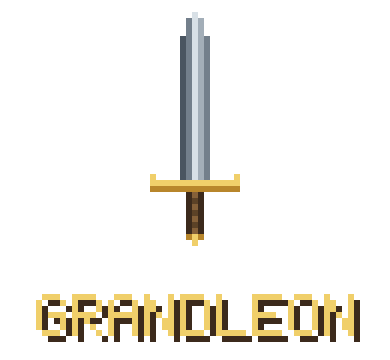
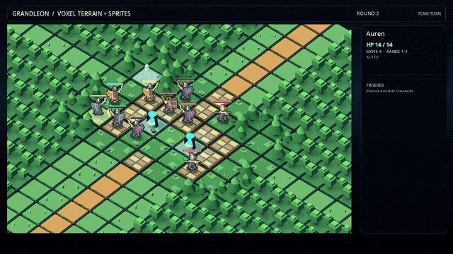
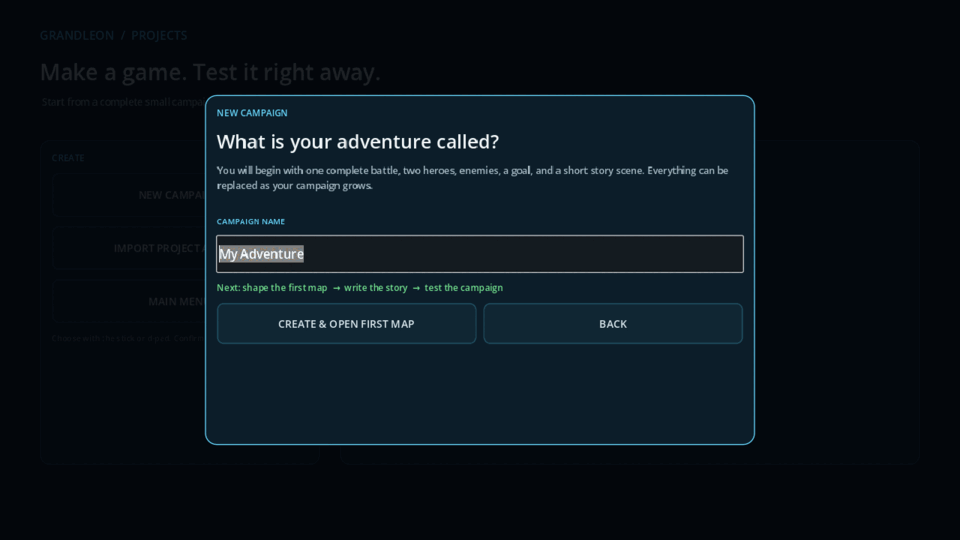
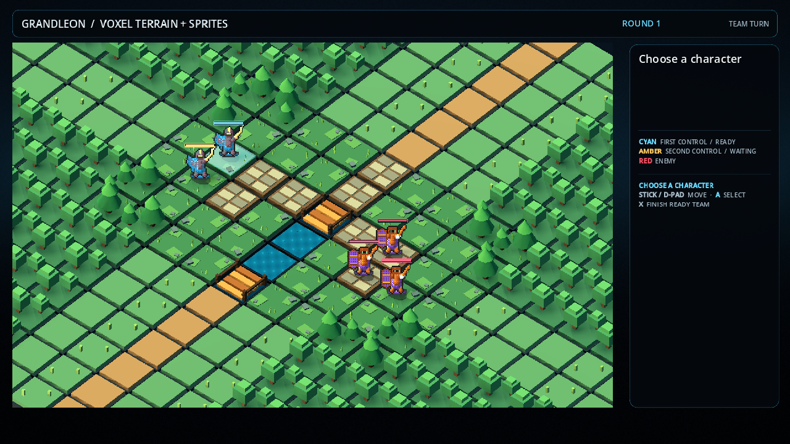
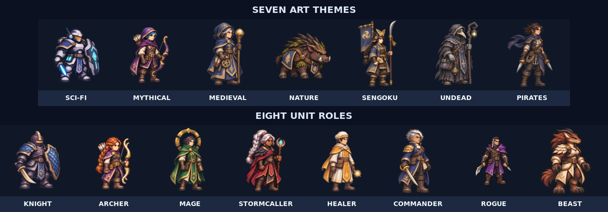
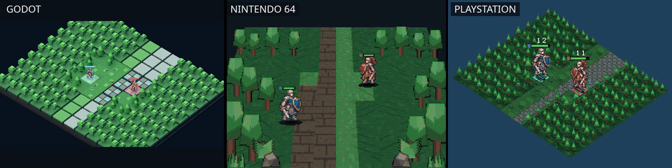

<p align="center">
  
</p>

# Grandleon

Grandleon is a tool for making and playing tactical role-playing games. Its
Godot application includes both the campaign creator and the PC player. The
same project can also be built for Nintendo 64 and PlayStation without changing
its rules.



The animation above is captured from the included sample campaign in the running
Godot client. It follows the party into close combat and includes the live
movement, attack, hit, and impact animations. It is not a mockup or concept
render.

## Make a game

Open Grandleon, choose **Create / Edit Games**, then **New Campaign**. Enter a
name and choose **Create & Open First Map**. The new campaign starts playable:
it already has two heroes, opponents, a goal, a conversation, local co-op
ownership, and an ending.



From there you can:

- paint and resize maps;
- place characters and divide allies between two local players;
- write story scenes and in-battle conversations;
- create roles, factions, weapons, items, abilities, and rewards;
- define objectives and branching outcomes;
- test the current draft immediately; and
- export an editable project or a player-only game.

The creator is designed around ordinary game-making tasks rather than source
files or internal identifiers. [Creating a game](docs/CREATING_A_GAME.md) is a
short visual tour of the current workflow; the full tutorial is planned once
the editor settles closer to 1.0.

## Play the included campaigns

The home screen includes two complete examples with their intended player
counts shown before launch:

- **The Tarnholt Line** (one player). The earlier six-battle campaign is a
  longer solo test of branching story, recruitment, deployment, survival
  goals, and a final boss.
- **Emberbound: The Last Dawn** (one or two players). Choose at launch. In
  co-op, the five-battle campaign divides one allied company between two
  independent controls; in solo, one player commands the complete company.

These are separate compiled games, not two labels for the same package. They
also remain portable projects under `games/tarnholt` and `games/emberbound`, so
the engine and console tests exercise the same authored source as the PC
examples.

## The Godot presentation

Godot is the main player and creator. Its supported presentation combines
authored 3D terrain with animated high-resolution 2D characters.



The current Godot art pack covers all eight character archetypes and all
thirteen terrain kinds. Its seven directions are sci-fi, mythical, medieval,
nature, Sengoku, Undead, and Pirates. Each has male and female designs for every
archetype. Either body can wear any of the six faction colours without
recolouring faces, hair, equipment, or effects. A separate lower-resolution
pixel library supplies shared previews and interface art; console exports
require the curated sheets shown here.



This is a quick sample rather than the whole catalog. See the
[artwork and animation roster](docs/ARTWORK.md) for animated previews and exact
coverage.

Boards larger than the readable view scroll horizontally and vertically on
Godot, Nintendo 64, and PlayStation. Small maps stay centered; on large maps,
the camera follows the active cursor without shrinking characters into
unreadable tokens.

Godot can also switch from the board to an optional terrain-derived close view
for an attack, its reported damage or miss, any legal counterattack, and a
defeat. The session menu can disable these **Battle Close-ups** or use
**Reduced** cinematic motion. Hold Confirm to fast-forward a close-up or press
Cancel to skip it; either choice returns to the authoritative board state that
the shared engine already accepted.
The live board remains visible as the camera focuses the two units and pushes
into the close view, then the result dissolves back to that settled board.
Reduced motion replaces the push with a short crossfade.
The in-game Settings menu can also show a small live FPS counter on any
renderer. It is off by default, including in console ROMs and disc images.

## One project, several targets

Portable project source is compiled into the same deterministic rules on each
target. Rendering and controls differ, but movement, combat, objectives,
campaign state, and random results remain authoritative in the shared engine.



This is a matched capture from the playable Godot, Nintendo 64, and PlayStation
campaign presentations. The console release checks exercise these same
renderers inside their campaign executables, rather than separate graphics
demos.

The installed Export Center can produce:

- a portable `.grandleon.zip` project;
- a standalone Linux PC game;
- a Nintendo 64 `.z64` ROM when its optional builder is installed; and
- a PlayStation `.bin`/`.cue` pair when its optional builder is installed.

Console builders are separate downloads because their pinned toolchains are
large. They work offline after installation. The PlayStation image has no Sony
licence sector and therefore does not boot on an unmodified retail console.
Each console has one renderer. It uses the curated character artwork as
hardware-sized cutouts over textured tactical terrain, with full-frame
terrain backdrops for close battles. There is no renderer choice in the game
or in **Finish & Export**.

`games/sevenfold` is the compact N64 showcase campaign. One ROM asks for one or
two players on its main menu, fields every archetype across all seven art
styles, and uses seven different maps covering every terrain kind. A debug
Stage-picker build can jump directly between the gates for review.

Ready-to-test Nintendo 64 and PlayStation images are included with the source
under [release/0.4.0](release/0.4.0/README.md).

0.4 brings this renderer to Nintendo 64 and PlayStation. Console terrain and
animation will continue to improve after 0.4. See
[Playing on Nintendo 64 and PlayStation](docs/CONSOLE_RENDERER.md) for exports,
controls, limits, and development builds.

## Roadmap

The roadmap is intentionally short. Completed versions are milestones; the
rest of the documentation describes the current Godot application.

| Version | Focus |
|---|---|
| **0.1** | Portable foundation. Established readable project source, deterministic tactical rules, an early creator, and working terminal and console presentations. |
| **0.2** | Complete campaign runtime. Added richer campaign play, in-battle dialogue, progression and inventory, weapon relationships, larger scrolling boards, console export work, and cross-target conformance for the shipped campaigns. |
| **0.3** | Godot player and creator. Moved the supported PC experience to Godot, joined creation and play in one application, and added local co-op, standalone export, authored 3D terrain, and a complete high-resolution sci-fi archetype roster. |
| **0.4** | Broader art and console campaigns. Completes seven coherent Godot character directions, improves terrain clusters and movement presentation, adds portable one/two/choice campaign launch policy, streamlines the player around a nearly full-screen board, includes distinct solo and local co-op campaigns, and uses one textured renderer for the PlayStation and Nintendo 64 campaigns. It also introduces the first optional terrain-aware Godot combat close-up. |
| **0.5** | Editor and localization product pass. Concentrates on the complete authoring experience: a friendly player-mode workflow, clearer creation steps, stronger previews and validation, safer project migration and deletion, better organization for larger games, and an end-to-end test that creates, exports, launches, and wins a game through the normal Godot screens. The work also localizes Grandleon's Godot shell and adds a **Translations** step where authors manually review player-facing text and character names, find missing or outdated work, preview a language, and export the localized project. Authors can mark selected characters as player-nameable while keeping a translated game default; players can choose and save those names on Godot, Nintendo 64, and PlayStation. |
| **Prior to 1.0** | Expand terrain-aware backdrops for combat and conversations, with optional ambient motion such as moving water, weather, foliage, light, and particles. Continue improving console character readability, terrain variety, animation, effects, interface clarity, close-up scenes, and performance measured on real hardware. Experiment with Android and, if practical, iOS exports of the Godot player and creator using the same portable games and presentation. Completely rework audio across music, ambience, battle effects, interface feedback, mixing, and platform consistency. Static backdrops remain the dependable fallback. |

Importing external artwork may be explored later, but it is not part of the
current roadmap commitment.

The first localization workflow will be deliberately manual. A later version
may optionally offer translation suggestions from an external AI service, but
suggestions must never be required, silently overwrite authored text, or
replace the author's review and approval.

The first localization workflow is usable end to end. Grandleon's home,
project, and every current creator screen are available in English, Spanish,
and Brazilian Portuguese. A clean
install follows the system locale when it is supported, but the language can be
changed explicitly from either the home or project screen, applies immediately
without a restart, and is remembered from then on. Missing shell copy falls
back to English. An automated catalog audit keeps all three languages on the
same non-empty message IDs and formatting placeholders. The Godot player's
session menu, display settings, save/checkpoint flow, diagnostics, and
dialogue-continue prompt follow the same language choice. Its live battle turn
chip, unit card, action popup, contextual controls, controller ownership, and
common refusal messages do as well. Campaign results, deployment and controller
notices, runtime warnings, and the optional Company screen are localized too;
fixed formations continue directly into play without showing that screen.

Games now record their own source language and carry manual translations in
the same portable project and compiled package. Open a project's
**Translations** screen to add a language (including `pt-BR`), review all
gathered player-facing copy and character names, search the catalog, and filter
missing or outdated work. Before a translated game starts, the player chooses
from its authored languages. Godot then applies that choice to the game title,
campaign and stage names, dialogue, objectives, company character names, named
battle placements, and named units, weapons, abilities, and items. Grandleon
keeps the original source strings; missing or outdated work falls back to the
current source rather than stale or empty text. Console interface localization
is still being audited during the 0.5 work. Player-chosen character names remain literal
player input rather than translation material; they survive save and continue
and can appear in
dialogue, objectives, rosters, and exact on-board unit labels. The compact
consoles offer a bounded controller keyboard using the characters their shared
font can display.

The concrete presentation experiments currently in progress are kept in the
short [development TODO](TODO.md).

## Build and run from source

To build the same self-contained Linux application used by players and authors:

```sh
platform/godot/scripts/build-steamos.sh --output out/grandleon-pc
GRANDLEON_WINDOWED=1 out/grandleon-pc/launch-pc.sh
```

To build only the shared native engine and package tools:

```sh
cmake -S . -B build -DGRANDLEON_BUILD_TESTS=OFF
cmake --build build
./build/grandleon_content_compile \
  games/emberbound/source/project.json build/emberbound.gpk
./build/grandleon_package_check build/emberbound.gpk
```

Developer setup, test dependencies, and console commands are in
[Setting up](docs/SETUP.md). Architecture and contribution guidance are in
[CODING.md](CODING.md) and [CONTRIBUTING.md](CONTRIBUTING.md).

## Project files

- `project.json` is the readable authoring source.
- `.grandleon.zip` is the portable editable project archive.
- `.gpk` is the compiled package consumed by runtimes.

Projects, saves, controls, recovery data, and exports live in per-user runtime
storage. Portable archives do not contain usernames, machine paths,
credentials, controller identities, or local settings.

Projects exported by earlier Grandleon releases can be imported from the Godot
Projects screen. When a stored project needs a schema update, its card explains
the update before anything changes. Opening it keeps the original readable
source under that project's recovery data, performs the update, and reports
the result. An unreadable source is left untouched instead of being replaced.
Portable project assets transfer; local recovery data and playtest progress do
not.

> **Back up projects while the editor evolves.** We still plan to do heavy work
> on the editor throughout the next releases, and we will update the schema
> version with those changes. Existing projects should import through the
> migration path, but until the editor reaches a stable format they may need
> occasional adjustments. Back up your game at multiple stages before
> upgrading, and report any import or migration issue you find.

## Documentation

| I want to… | Read |
|---|---|
| make a campaign | [Creating a game](docs/CREATING_A_GAME.md) |
| inspect characters, animation, and terrain | [Artwork and animation roster](docs/ARTWORK.md) |
| tweak or regenerate a character | [Artwork generation and tweak guide](docs/ARTWORK_GENERATION.md) |
| play or export on a console | [Nintendo 64 and PlayStation](docs/CONSOLE_RENDERER.md) |
| build or contribute | [Setting up](docs/SETUP.md) and [Contributing](CONTRIBUTING.md) |

## Licence

Grandleon is released under the [MIT License](LICENSE). Bundled dependencies
retain their own licences and notices.

## Author

Luis Felipe Strano Moraes, luis.strano at gmail dot com
