# Artwork and animation roster

Grandleon has artwork for all eight character archetypes and all thirteen
terrain kinds. The supported Godot presentation, **Voxel + Sprites**, combines
authored 3D terrain with animated high-resolution characters.

This page separates two useful meanings of “complete”:

- The supported Godot presentation has male and female high-resolution
  characters for every archetype in the sci-fi, mythical, medieval, nature,
  Sengoku, Undead, and Pirates directions. All seven support the six faction
  colours. Godot also
  has one
  authored scene for each of the thirteen terrains.
- The portable generated library covers every combination of eight archetypes,
  seven styles, six faction colours, and two figures. These are the assets shared
  with the constrained renderers and used as a safe fallback in Godot.

The sci-fi direction established the high-resolution sheet contract. Mythical
was the first expansion; medieval, nature, Sengoku, Undead, and Pirates are
0.4 additions. All seven follow the same contract. This is the mythical roster:

| Portable identity | Animated preview |
|---|---|
| Knight · male (`first`) · blue | 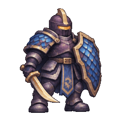 |
| Knight · female (`second`) · blue | 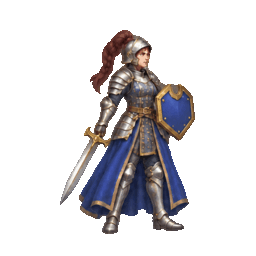 |
| Archer · male (`first`) · violet | 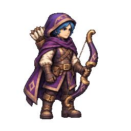 |
| Archer · female (`second`) · violet | 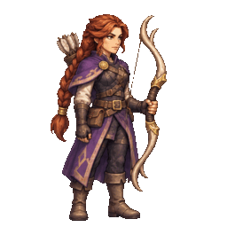 |
| Mage · male (`first`) · green | 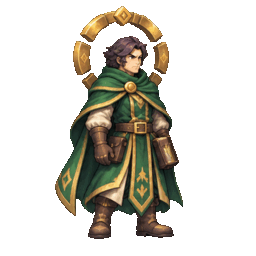 |
| Mage · female (`second`) · green | 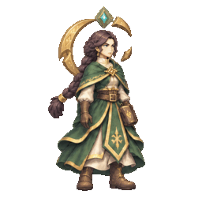 |
| Healer · male (`first`) · amber | 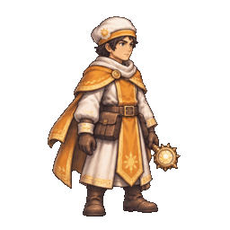 |
| Healer · female (`second`) · amber | 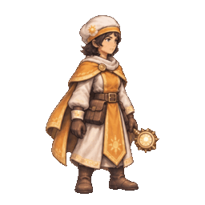 |
| Commander · male (`first`) · blue | 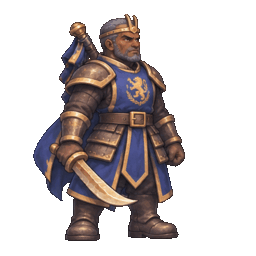 |
| Commander · female (`second`) · blue | 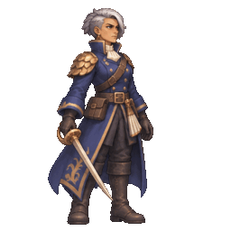 |
| Stormcaller · male (`first`) · red | 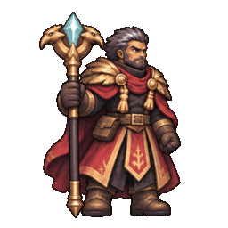 |
| Stormcaller · female (`second`) · red | 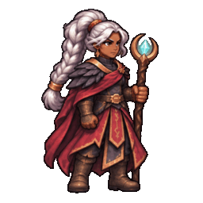 |
| Rogue · male (`first`) · violet | 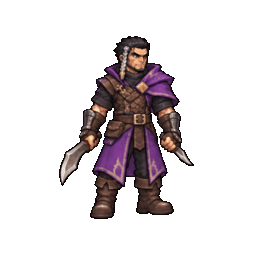 |
| Rogue · female (`second`) · violet | 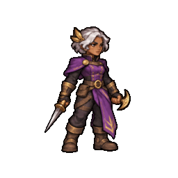 |
| Beast · male (`first`) · bone | 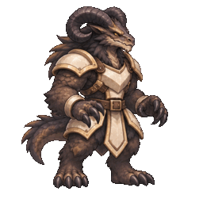 |
| Beast · female (`second`) · bone | 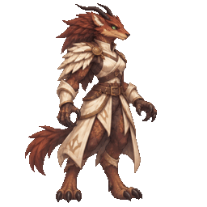 |

These eight finished body pairs cover every mythical archetype. The names
describe their portable art identity, not a campaign. The same coverage now
exists for all seven styles. The portable generated library remains available
as a safe fallback if an individual curated binding or file is missing.

## Bodies and team colours

Every character archetype has two body variants. The project file stores them
as `first` and `second` for compatibility; the creator presents those choices
to people as **Male** and **Female**. The portable generated library already
draws both bodies for every archetype, style, and faction colour.

The high-resolution roster uses one male and one female source sheet per
archetype and style. These are independent character designs, not the same
costume placed on two bodies: faces, hair, stature, clothing construction,
equipment styling, and silhouettes may all differ. What stays consistent is
the archetype, the eight-action sheet contract, equipment handedness where the
renderer depends on it, and a large readable team-colour region.

Independent does not mean unrelated. Every sheet follows the same compact
tactical art direction: roughly three-and-a-half heads tall, slightly oversized
heads and hands, strong dark contours, simplified painterly materials, a shared
three-quarter camera, and consistent board-scale framing. Body type can vary,
but a pair should still look as though it was made by the same art team for the
same game.

It does not require six separately painted copies of each body. Every curated
source sheet has a team-colour mask. Godot recolours only the marked cloth and
armour into blue, red, green, violet, amber, or bone, then caches the finished
texture for the battlefield, portraits, and creator previews. Faces, hair,
weapons, and spell effects remain unchanged. If a mask is missing or malformed,
Godot keeps the original source colour instead of failing the character.

The generated comparison galleries show every curated body in every faction
colour at portrait and board scale:

- [Browse all 96 mythical body-and-colour combinations](screenshots/art-roster/team-colours/index.html).
- [Inspect the mask selection on idle poses](screenshots/art-roster/team-colours/mythical-team-masks-idle.png).
- [Inspect the mask selection across every action](screenshots/art-roster/team-colours/mythical-team-masks-actions.png).
- [Browse all 96 sci-fi body-and-colour combinations](screenshots/art-roster/team-colours/scifi/index.html).
- [Inspect the sci-fi masks on idle poses](screenshots/art-roster/team-colours/scifi/scifi-team-masks-idle.png).
- [Inspect the sci-fi masks across every action](screenshots/art-roster/team-colours/scifi/scifi-team-masks-actions.png).
- [Browse all 96 medieval body-and-colour combinations](screenshots/art-roster/team-colours/medieval/index.html).
- [Inspect the medieval masks on idle poses](screenshots/art-roster/team-colours/medieval/medieval-team-masks-idle.png).
- [Inspect the medieval masks across every action](screenshots/art-roster/team-colours/medieval/medieval-team-masks-actions.png).
- [Browse all 96 nature body-and-colour combinations](screenshots/art-roster/team-colours/nature/index.html).
- [Inspect the nature masks on idle poses](screenshots/art-roster/team-colours/nature/nature-team-masks-idle.png).
- [Inspect the nature masks across every action](screenshots/art-roster/team-colours/nature/nature-team-masks-actions.png).
- [Browse all 96 Sengoku body-and-colour combinations](screenshots/art-roster/team-colours/sengoku/index.html).
- [Inspect the Sengoku masks on idle poses](screenshots/art-roster/team-colours/sengoku/sengoku-team-masks-idle.png).
- [Inspect the Sengoku masks across every action](screenshots/art-roster/team-colours/sengoku/sengoku-team-masks-actions.png).
- [Browse all 96 Undead body-and-colour combinations](screenshots/art-roster/team-colours/undead/index.html).
- [Inspect the Undead masks on idle poses](screenshots/art-roster/team-colours/undead/undead-team-masks-idle.png).
- [Inspect the Undead masks across every action](screenshots/art-roster/team-colours/undead/undead-team-masks-actions.png).
- [Browse all 96 Pirates body-and-colour combinations](screenshots/art-roster/team-colours/pirates/index.html).
- [Inspect the Pirates masks on idle poses](screenshots/art-roster/team-colours/pirates/pirates-team-masks-idle.png).
- [Inspect the Pirates masks across every action](screenshots/art-roster/team-colours/pirates/pirates-team-masks-actions.png).

## Animated sci-fi Godot roster

These are the actual committed sheets used by the supported presentation. Each
preview runs through idle, walk, attack, ability, and hurt/defeat poses.

| Archetype | Male (`first`) | Female (`second`) |
|---|---|---|
| Knight | 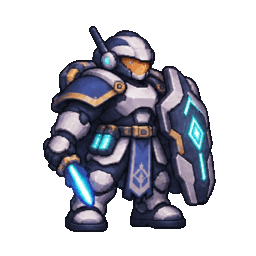 | 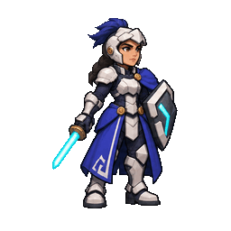 |
| Archer | 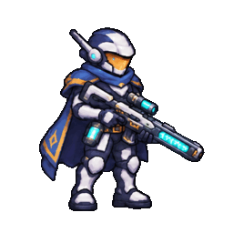 | 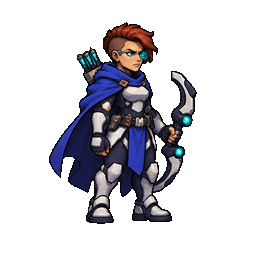 |
| Mage | 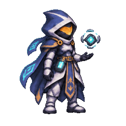 | 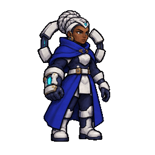 |
| Stormcaller | 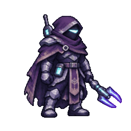 | 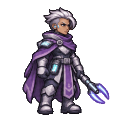 |
| Healer | 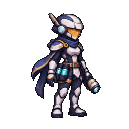 | 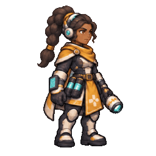 |
| Commander | 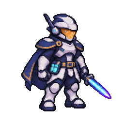 | 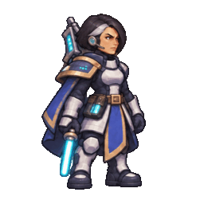 |
| Rogue | 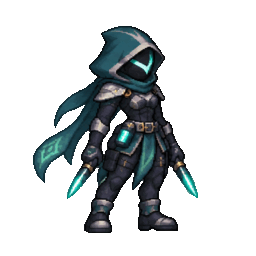 | 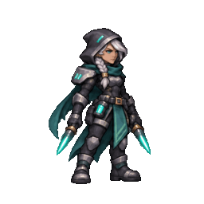 |
| Beast | 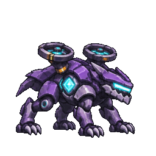 | 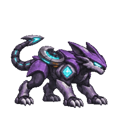 |

Every source sheet is a transparent 4×2 image made of eight 443×443 cells:
idle A, idle B, walk A, walk B, attack wind-up, attack follow-through, ability,
and hurt/defeat. The graphics profile owns the timing, pivot, and directional
mirroring, so replacing a sheet does not change a campaign or its rules.

## Animated medieval Godot roster

The medieval roster uses grounded steel, leather, cloth, wood, and heraldry.
The two bodies are independently designed while sharing one company palette,
camera, scale, and material language.

| Archetype | Male (`first`) | Female (`second`) |
|---|---|---|
| Knight | 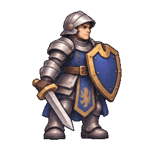 | 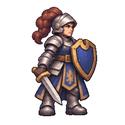 |
| Archer | 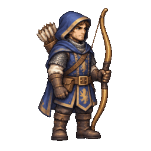 | 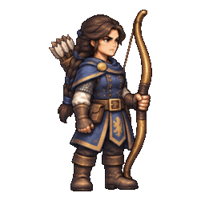 |
| Mage | 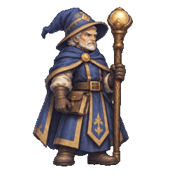 | 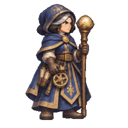 |
| Stormcaller | 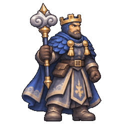 | 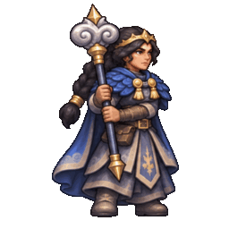 |
| Healer | 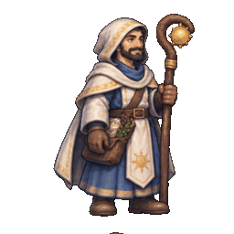 | 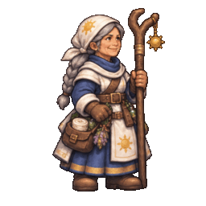 |
| Commander | 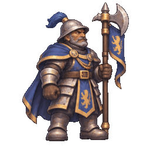 | 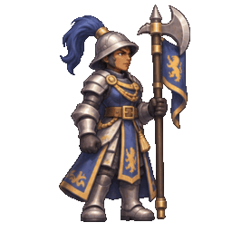 |
| Rogue | 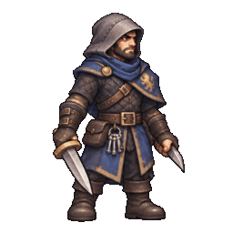 | 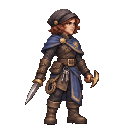 |
| Beast | 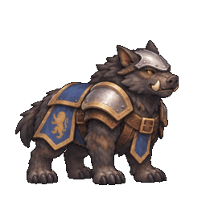 | 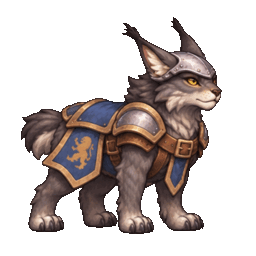 |

## Animated nature Godot roster

Nature uses animal-folk silhouettes, bark, leaf, leather, and warm metal. Each
body pair is deliberately different while retaining one woodland faction
language and broad blue cloth regions for team recolouring.

| Archetype | Male (`first`) | Female (`second`) |
|---|---|---|
| Knight | 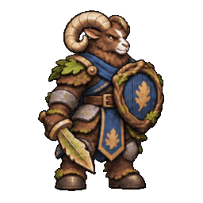 | 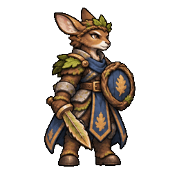 |
| Archer |  |  |
| Mage |  |  |
| Stormcaller |  |  |
| Healer |  |  |
| Commander |  |  |
| Rogue |  |  |
| Beast |  |  |

## Animated Sengoku Godot roster

The Sengoku roster uses lacquered lamellar armour, indigo cloth, period-inspired
weapons and ritual tools, and subtle woodblock influence. Male and female
counterparts share one faction language without sharing a single costume.

| Archetype | Male (`first`) | Female (`second`) |
|---|---|---|
| Knight |  |  |
| Archer |  |  |
| Mage |  |  |
| Stormcaller |  |  |
| Healer |  |  |
| Commander |  |  |
| Rogue |  |  |
| Beast |  |  |

## Animated Undead Godot roster

The Undead roster uses corroded dark iron, old ivory bone, worn leather,
tattered indigo heraldry, and pale green spectral effects. Male and female
counterparts share that gothic storybook language while keeping clearly
different silhouettes and equipment treatments.

| Archetype | Male (`first`) | Female (`second`) |
|---|---|---|
| Knight |  |  |
| Archer |  |  |
| Mage |  |  |
| Stormcaller |  |  |
| Healer |  |  |
| Commander |  |  |
| Rogue |  |  |
| Beast |  |  |

## Animated Pirates Godot roster

The Pirates roster uses weathered leather and linen, tarnished brass, dark
wood, naval indigo, and pale sea-green or warm-gold effects. The age-of-sail
language is shared across the roster while each role keeps unmistakable tools,
clothing construction, and movement silhouettes.

| Archetype | Male (`first`) | Female (`second`) |
|---|---|---|
| Knight |  |  |
| Archer |  |  |
| Mage |  |  |
| Stormcaller |  |  |
| Healer |  |  |
| Commander |  |  |
| Rogue |  |  |
| Beast |  |  |

Run the following command after changing a sheet to rebuild the previews:

```sh
platform/godot/scripts/generate-art-roster.sh
```

Run these after changing a curated sheet, mask, or faction palette to rebuild
the masks and both six-colour review galleries:

```sh
tools/placeholder_art/.venv/bin/python \
  platform/godot/scripts/generate-mythical-team-masks.py --style mythical
tools/placeholder_art/.venv/bin/python \
  platform/godot/scripts/generate-mythical-team-masks.py --style scifi
tools/placeholder_art/.venv/bin/python \
  platform/godot/scripts/generate-mythical-team-masks.py --style medieval
tools/placeholder_art/.venv/bin/python \
  platform/godot/scripts/generate-mythical-team-masks.py --style nature
tools/placeholder_art/.venv/bin/python \
  platform/godot/scripts/generate-mythical-team-masks.py --style sengoku
tools/placeholder_art/.venv/bin/python \
  platform/godot/scripts/generate-mythical-team-masks.py --style undead
tools/placeholder_art/.venv/bin/python \
  platform/godot/scripts/generate-mythical-team-masks.py --style pirates
platform/godot/scripts/generate-team-colour-showcase.sh
platform/godot/scripts/generate-team-colour-showcase.sh --style scifi
platform/godot/scripts/generate-team-colour-showcase.sh --style medieval
platform/godot/scripts/generate-team-colour-showcase.sh --style nature
platform/godot/scripts/generate-team-colour-showcase.sh --style sengoku
platform/godot/scripts/generate-team-colour-showcase.sh --style undead
platform/godot/scripts/generate-team-colour-showcase.sh --style pirates
```

## Terrain coverage

The authored Godot terrain pack covers:

> grass, farmland, sand, snow, swamp, hills, bamboo, forest, mountain, water,
> road, paved, and ruins

Road tiles can select the separate bridge scene when they meet water. Several
asymmetric scenes also have deterministic rotated variants, giving repeated
terrain some variety without adding randomness to portable game data. If a
replacement scene is missing or invalid, the renderer falls back on that tile
instead of making the whole art pack unusable.

The bindings live in
[`graphics_profiles.json`](../platform/godot/project/content/graphics_profiles.json),
the character sources live in
[`platform/godot/project/art/characters`](../platform/godot/project/art/characters),
and the terrain scenes live in
[`platform/godot/project/art/terrain`](../platform/godot/project/art/terrain).

## Movement presentation

Godot keeps the accepted grid route and its duration exactly as supplied by
the simulation. The renderer eases only the picture at the beginning and end
of that route, blends the character's facing across corners, and uses distance
travelled to keep the walk frames and small body motion in phase. Terrain
height is still interpolated between the two accepted cells. Interrupted moves
start from the character's current visual position, while simultaneous
two-player moves retain independent presentation state.

This smoothing never changes movement range, route cells, arrival time,
destination, input authority, or the portable state hash.

## The full portable library

The portable art generator contains 672 standing character assets: eight
archetypes × seven styles × six faction colours × two figures. It also emits
their animation poses and the complete thirteen-terrain set for the modern and
console-oriented output profiles.

- [Browse all 56 archetype-and-style combinations](../tools/placeholder_art/ROSTER.md).
- [Browse terrain, transitions, animation frames, palettes, and output profiles](../tools/placeholder_art/GALLERY.md).

This larger library is deliberately lower resolution. It exists so every valid
portable project remains visible on every renderer. The curated Godot rosters
are the high-resolution presentation, not a promise of a separately painted
sheet for every colour and body combination.

## Source and licence

The character sheets were generated for this project in built-in
image-generation mode. Existing sheets and the portable roster were used as
visual and design references. Each prompt requests a transparent 4×2 production
sheet, one consistent character, the eight poses listed above, no text or
scenery, and a readable tactical-game silhouette. Generated images are cropped
to exact cell boundaries without repainting the output.

Grandleon's source and project-owned artwork are offered under the repository's
[MIT License](../LICENSE). Bundled tools and runtimes retain their own licences
and notices. External art-pack import is not part of the current editor and may
be reconsidered after the built-in art directions are complete.
