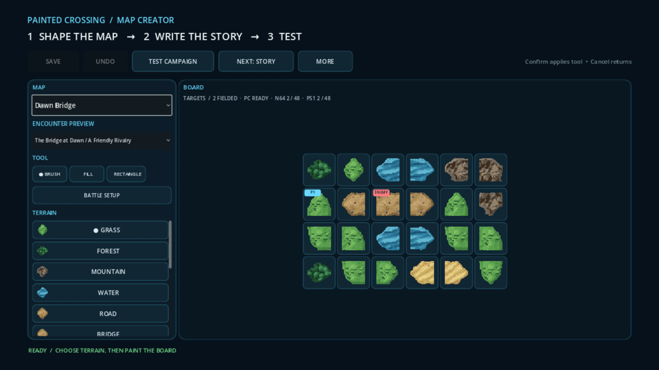
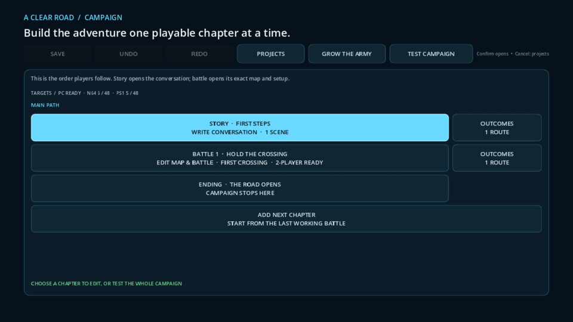
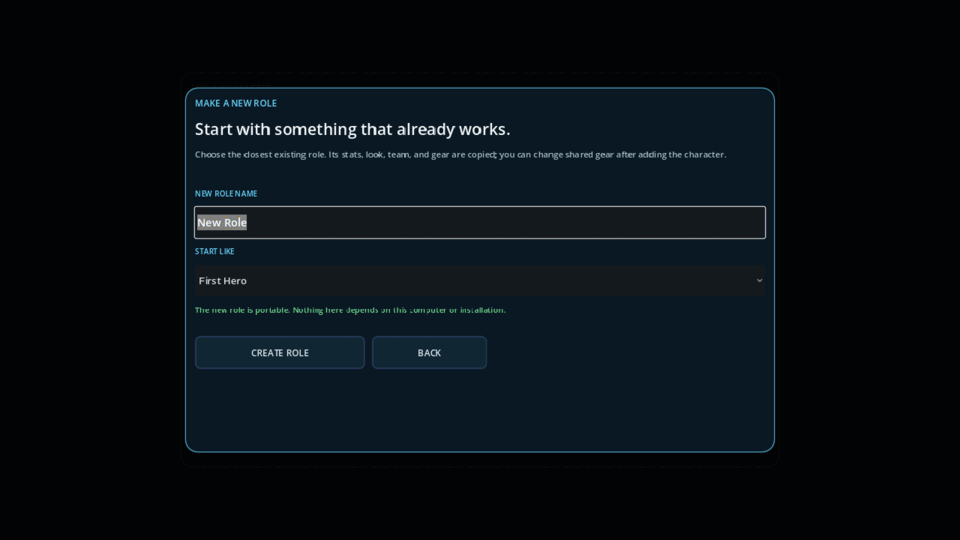
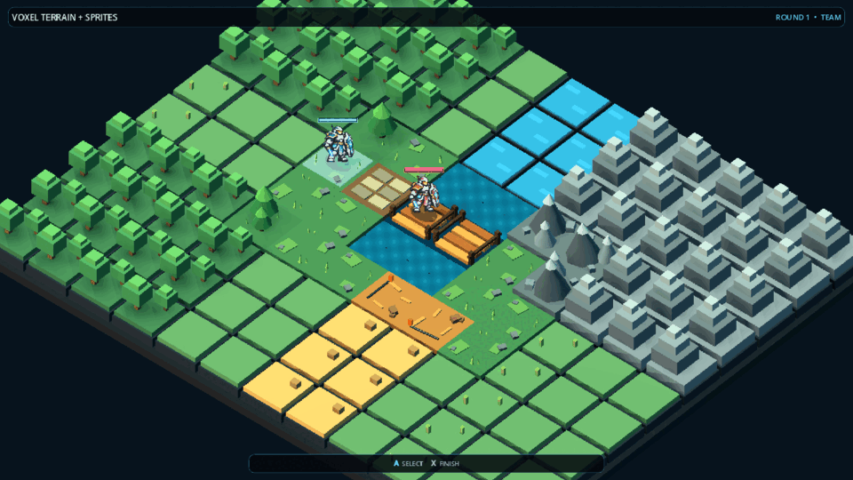

# Creating a game

Grandleon's PC application includes both the player and the campaign creator.
A new campaign starts with a small playable chapter, so the normal workflow is
simple: make a change, test it, and keep building from what works.

This page is a visual tour of the current creator, not a permanent reference
manual. The editor will change substantially before 1.0, when the project will
publish a complete step-by-step tutorial.

## Start with something playable

Choose **Create / Edit Games**, then **New Campaign**. Give the campaign a
title and choose **Create & Open First Map**.


The starter includes two heroes, opponents, a short conversation, a battle
goal, local co-op ownership, and an ending. You can play it immediately or
replace each part at your own pace.

## Shape the first battle

The map screen is where you paint terrain and arrange the encounter. **Brush**,
**Fill**, and **Rectangle** cover the common painting jobs; **Undo** and
**Redo** make it safe to experiment.

The **Landmarks** row places a village house or ancient grove as one complete
2×2 blocked feature. Choose the feature, then choose its top-left map cell.
**Remove** clears the whole feature even when you choose a different one of its
four cells; houses return to paved ground and groves return to forest. The
editor refuses an edge, overlapping feature, character, or deployment area
that cannot hold the complete footprint, so it never saves half a landmark.



From the same screen you can:

- place, move, and remove allied and opposing units;
- place and remove complete 2×2 houses and ancient groves;
- assign allied units to Player 1 or Player 2;
- add opponents that appear only in a two-player game;
- choose deployment areas, limit how many allies may be fielded, and set battle goals;
- paint rooms that begin visually covered and choose their local reveal radius;
- schedule reinforcement waves or give an opponent a numbered patrol route;
- order scenes that play when the battle opens or a named character falls;
- add a conversation that starts when a unit is approached; and
- choose the terrain theme, character style, and faction colours.

These less-common controls live together under **Battle Setup**. For a patrol,
choose an opponent under **Opening Forces & Waves**, select **Follow Patrol
Route**, and place the numbered waypoints in visit order on the map. A fielding
limit appears beside the deployment-area controls; the editor only offers
limits that could actually change the authored company. **Scripted Battle
Moments** shows scenes in their real play order, including Talk scenes, and can
create openings or character-fall scenes for everyone or only for co-op. The
scene itself is still written in **Story**, so it can be reused later.

**Interior Visibility** is also under Battle Setup. Choose a reveal radius,
then paint the rooms or building cells that should begin covered. The map shows
those cells immediately, and a friendly unit reveals nearby marked cells after
entering during a PC test. Explored cells stay visible for that battle. This is
currently presentation only—it does not hide legal moves or enemies from the
rules, change the AI, or alter objectives—and matching console presentation is
still planned rather than implied.

**Map Surroundings** controls the decorative ground beyond the bright playable
boundary. **Continue Map Edges** carries the nearest edge terrain outward,
**Fill With One Terrain** uses a terrain you choose, and **Natural Blend**
mixes that terrain into the edge in a repeatable pattern. The map updates while
you choose, before you apply. These cells are visual only: they never become
movement cells, and the player camera remains centred on small maps or clamped
to the authored playable map when a large map scrolls.

The [artwork and animation roster](ARTWORK.md) shows every included style and
unit. Grandleon currently uses its built-in art library; importing a custom art
pack is not currently part of the creator.

## Write the story

Open **Story** to choose a speaker, portrait, backdrop, and dialogue. Add lines
for the common path; less frequent scene and ordering actions are under
**More**.

Choose **Play Order** beside **Add Scene** when one story moment should contain
several scenes. The numbered list is the real order players will see. You can
attach an existing reusable scene, move it earlier or later, or detach it from
that story moment. Detaching does not delete the scene or remove it from any
other story moment, so the same conversation can be reused safely.

Large story libraries can be searched by scene title, internal identity, or
speaker. **Delete This Scene** first shows every campaign or battle that still
uses the scene. A referenced scene cannot be deleted; an unused scene requires
a separate confirmation and can be restored with **Undo**. Campaigns, battles,
roles, sides, maps, gear, and abilities use the same fail-safe review.


Story text is saved with the project and shown consistently on PC, Nintendo
64, and PlayStation. Grandleon's own home, project, and creator screens are
available in English, Spanish, and Brazilian Portuguese. Choose the language
on either the home or project screen; the open screen updates immediately, and
Grandleon remembers the explicit choice instead of relying on the system
locale again.

To translate your game, open its project options and choose
**Translations**. Confirm the language the original text was written in, add a
target such as `es` or `pt-BR`, then work through the gathered dialogue, stage
labels, objectives, named battle characters, content names, and character
names. Search finds source copy, context, or stable message identity.
**Missing** shows work not started; **Outdated** shows translations reviewed
before their source copy changed. Saving a translation records both your
translated text and the exact source text you reviewed. A translation never
replaces its original string, and missing or outdated work resolves to the
current source text.

Use **Export .PO** to review the selected language in a gettext-compatible
translation tool, then **Import .PO** to bring it back. Grandleon keeps stable
message IDs in gettext context, preserves outdated entries as `fuzzy`, and
refuses a catalog for the wrong language or a translation that drops a named
placeholder. The project catalog remains the runtime source of truth.

Choose a campaign and player count at the bottom of the Translations screen,
then select **Play Language** to test the current catalog. This preview uses an
isolated save and returns to the Translations screen, so checking dialogue and
layout does not alter an ordinary campaign.

A game with translated catalogs asks for its language before play. The Godot
player applies it to the game title, campaign and stage names,
dialogue, company character names, objectives, named battle placements, and
named units, weapons, abilities, and items. Godot's player interface follows
the chosen Grandleon language: session and display settings,
checkpoints, dialogue controls, battle actions, campaign results, deployment
and controller notices, runtime warnings, and the optional Company screen.
Fixed formations skip that screen and begin immediately. Console interface
localization is still being audited.

## Add chapters and branches

**Continue Creating** opens the campaign outline. It presents the story,
battles, endings, and alternate routes in play order.



Use **Add Next Chapter** for a linear campaign. Use **Outcomes** when a battle
should lead somewhere different because of a win, loss, item, or conversation.
New chapters begin as playable copies of the last working setup, which is much
faster than rebuilding every placement and goal.

A project can hold several campaigns. Use the campaign selector to edit the
right one, or choose **Add Campaign** to start another from the current working
outline. The copy is playable immediately, but its route, roster, player-count
policy, and starting chapter are independent. Testing and game builds always
show which campaign they will start instead of silently choosing the first.

## Grow the army

**Grow the Army** manages heroes, recruits, roles, gear, abilities, growth,
rewards, and campaign supplies. A new role can start from an existing one and
then be tuned independently.



Visible names can change without breaking campaign progress. A character may
also be marked **Player can choose this name** while keeping its normal name as
the translated fallback. In Godot, the player can choose or reset that name
from the Company screen, and it survives save and continue. A duplicate company
name is allowed but called out clearly.

To use that choice in dialogue or an objective label, write an explicit member
token such as `{{member:aren}}`, using the character's internal campaign ID.
Each player replaces it with the authored default or the player's literal
choice; an unknown or malformed token stays visible so an authoring mistake is
easy to find.

Controller name entry is being reconnected to the new Nintendo 64 and
PlayStation players during the 0.5 engine transition. The intended console
contract is an 18-glyph shared-font limit, authored-default reset,
Cancel-without-writing, fixed-name exclusion, and no repeated prompt after a
continued save; until that cutover is complete, test this workflow in Godot.

Keep roles and gear small at first; add new choices when a chapter gives the
player a reason to use them.

The project, roster, gear, story, campaign, and translation screens include
search for larger games. **Where Used / Delete** on campaigns, battles, maps,
roles, sides, gear, abilities, and reusable story scenes shows named
dependencies before an unused definition can be removed. Used, shared,
missing, or unverifiable content is never deleted. Built-in terrain art,
character bodies, themes, and backdrops are library choices rather than
project-owned definitions, so they can be replaced but not deleted here.

For a new cast member, **Guided New Character** creates the named character,
an independent role, appearance, side, first weapon, and compatible loadout in
one undoable step. Start from the closest working role or ask for a randomized
starting point, review every suggestion, and tune it normally afterwards.

From **Gear & Abilities**, open **Combat Design** to make those choices readable
as a system. You can state which weapon family is strong against another, tune
the shared damage and hit-chance bonus, compare any two character types using
the same forecast arithmetic as play, and see target range and ability impact
areas on small grids before putting them into a battle.

## Test and export

Use the campaign outline's **Test 1 Player** or **Test 2 Players** action beside
a battle when you want to check that battle immediately. This works for later
chapters too: it opens the real authored map, placements, objectives, waves,
story moments, and the chosen one-player or two-player variant without making
you replay the campaign entrance.

A direct battle test is deliberately temporary. It starts from a clean authored
roster, makes later recruits available, does not load or replace campaign saves,
and stops after the selected battle. It does not pretend that earlier upgrades,
losses, rewards, or route choices happened. Use the toolbar's whole-campaign
test when those progression details are what you need to check. During either
draft test, open the session menu and choose **Return to Campaign Editor** to go
back to the same project.



**Finish & Export** can produce:

- an editable `.grandleon.zip` project;
- a standalone Linux player build;
- a Nintendo 64 `.z64` ROM when the optional builder is installed; and
- a PlayStation `.bin` and `.cue` pair when its optional builder is installed.

Console builders are separate downloads. Once installed, they work offline
and do not require a source checkout. The PlayStation image does not include a
Sony licence sector, so it does not boot on an unmodified retail console.

Under **Game Settings**, **Begin with Battle Close-ups** sets the game's
portable starting recommendation. A player can still override it locally; the
local accessibility choice always wins and does not change the project or its
saves.

## Keep projects safe

Export a `.grandleon.zip` at useful milestones and keep copies outside the
application's project library. Older projects can be imported into the current
creator. A project card warns before a schema update; opening it keeps the
original readable source as recovery data and reports the completed update.
Unreadable source is left untouched so it can be recovered or attached to a
bug report.

> We still plan to do heavy work on the editor throughout the next releases,
> and we will update the schema version with those changes. Existing projects
> should import through the migration path, but until the editor reaches a
> stable format they may need occasional adjustments. Back up your game at
> multiple stages before upgrading, and report any import or migration issue
> you find.

## Refresh this visual guide

The animations above come from scripted interactions with the real Godot
creator, not mockups. Rebuild them from a development checkout with:

```sh
platform/godot/scripts/capture-creator-guide.sh
```

Pass `--player-shell path/to/pc-bundle` to show the installed Linux export
target as available in the final animation.
