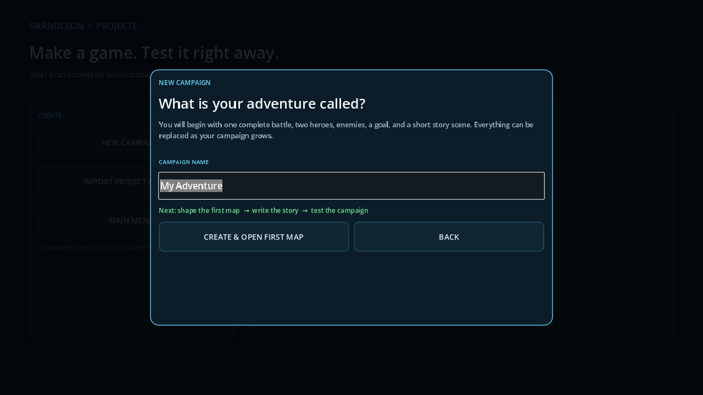
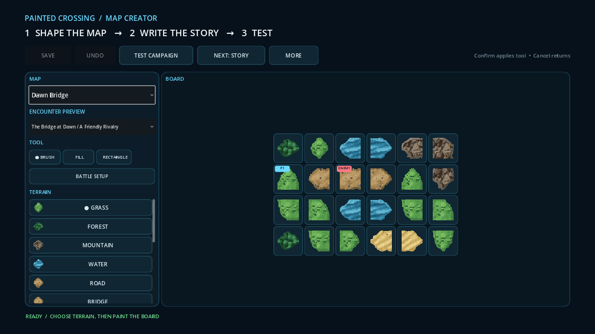
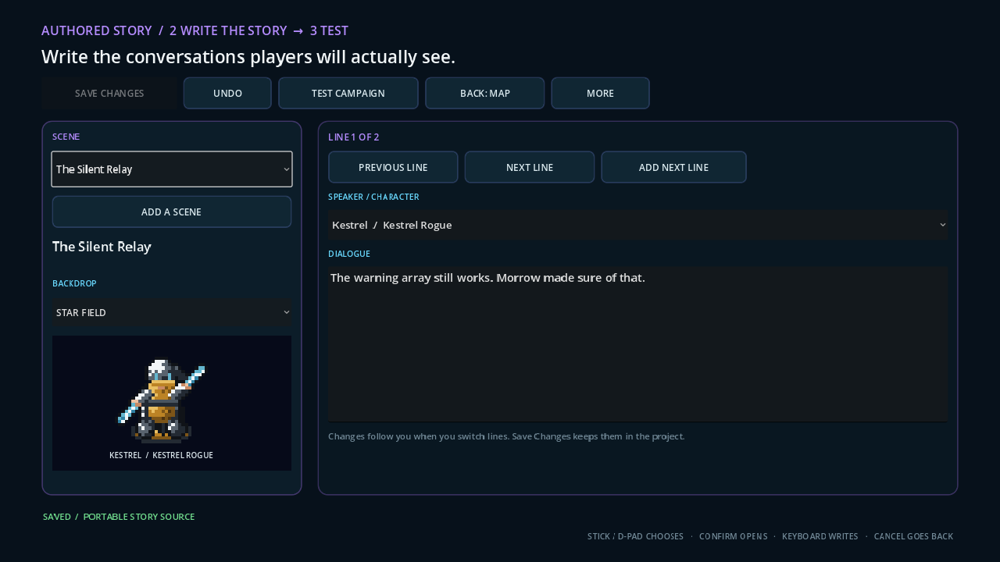
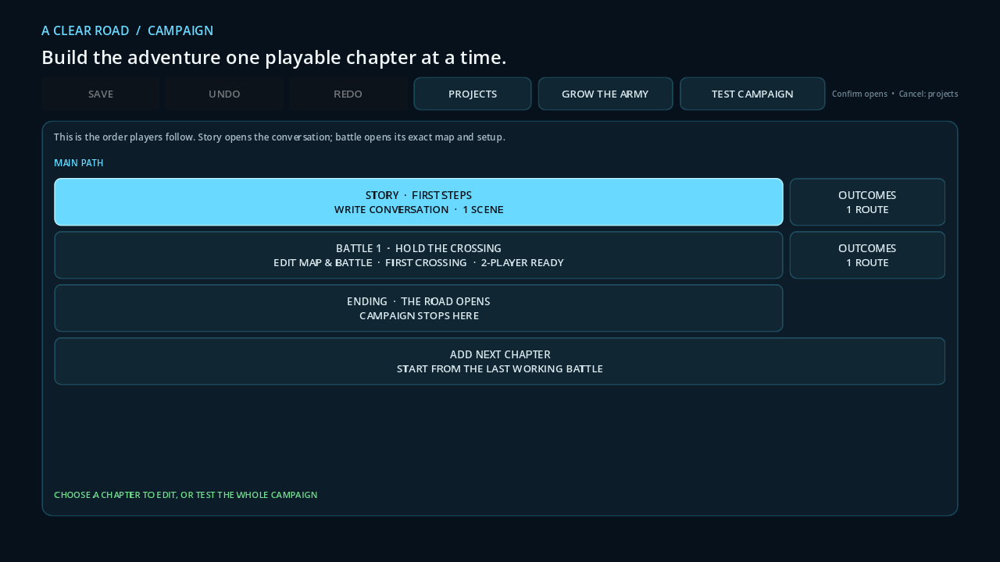
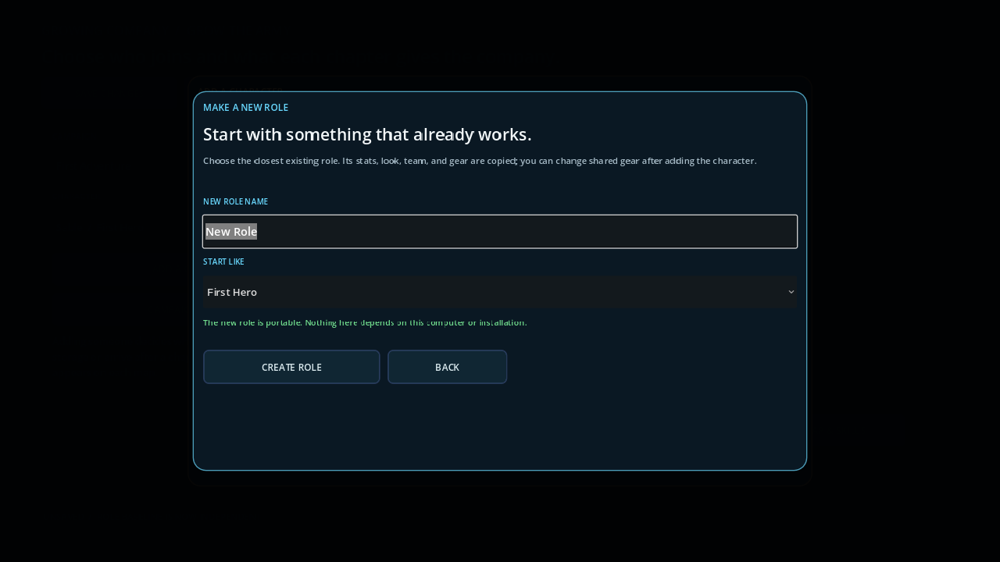
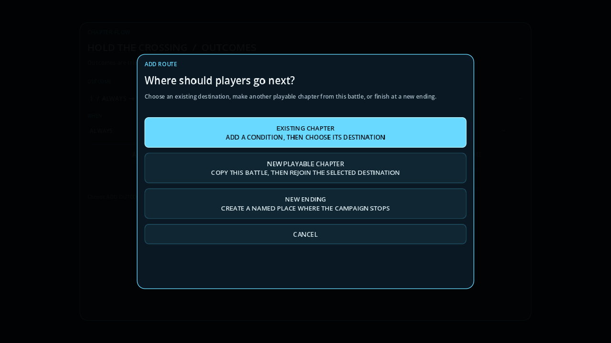

# Creating a game

Grandleon's PC application is both the player and the campaign creator. A new
campaign starts playable: it already has two heroes, opponents, a goal, a short
conversation, co-op ownership and scaling, and an ending. Creation is therefore
a loop of changing something, testing it, and keeping what is fun—not filling
an empty database before anything can run.

The essential creator flow is:

```text
New Campaign
  → shape the first map and battle
  → write its conversation
  → test the campaign
  → Continue Creating
  → add or branch a chapter
  → grow the army
  → test again
  → Finish & Export
```

Everything essential is reachable with a directional control, Confirm, and
Cancel. A keyboard is useful for names and dialogue. The footer on each screen
states what the available buttons do.

## Start a complete campaign

From the main menu choose **Create / Edit Games**, then **New Campaign**. Enter
the player-facing title and choose **Create & Open First Map**.



The title is not a file path or a machine identity. Grandleon creates portable
stable identities behind the screen and keeps them unchanged when a visible
name is edited later.

The starter is intentionally small but complete:

- Player 1 and Player 2 each own a hero in two-player mode; solo mode fields
  the whole allied company for Player 1.
- A two-player-only opponent demonstrates encounter scaling.
- The first goal ends the battle when all opponents are defeated.
- A story scene leads into the battle, and the battle leads to an ending.
- The map has an automatic non-playable surrounding edge, so the camera does
  not reveal a black void beyond the tactical area.

## Shape the map and battle

Creating the campaign opens its first map. Choose terrain, then paint with
**Brush**, **Fill**, or **Rectangle**. Confirm applies the selected tool; Cancel
returns from a focused action. **Undo** and **Save** operate on complete creator
commands rather than individual implementation details.



The map is reusable ground. **Encounter Preview** chooses the battle currently
overlaid on it. The cyan **P1**, amber **P2**, and red **Enemy** badges identify
ownership without adding permanent labels to the play HUD.

Open **Battle Setup** for the rules and pieces that belong to this encounter:

- add, move, or remove allied and opposing placements;
- assign each allied placement to Player 1 or Player 2;
- mark extra opponents that appear only with two local players;
- choose opposing characters that players may **Talk** to instead of defeating;
- edit the deployment region and its optional capacity;
- attach and author defeat, protect, and survive goals; or
- deliberately copy another battle's placements, goals, deployment, co-op
  ownership, scaling, and turn order while keeping this chapter's map and
  campaign position.

**Talk & Story Choices** asks only which opponent can be approached. Selecting
that character opens one small screen: **Write Conversation**, **Remove Talk**,
or **Done**. Write Conversation creates the portable in-battle moment and opens
its exact scene in the ordinary Story editor; returning later changes the first
action to **Edit Conversation**. Talking removes that opponent from the battle
alive and records the choice on PC, Nintendo 64, and PlayStation. Grandleon
creates the portable scene, moment, and memory identities behind the screen.
The author never names a flag or connects a dialogue ID.

Removing Talk also removes its unshared encounter conversation as one undoable
edit. Removal is refused while a campaign outcome still uses the choice, so a
route cannot silently become unreachable.

Copied battle setups deliberately leave Talk choices behind. A conversation
belongs to one encounter and should not silently share story memory with a
different chapter; enable Talk again on the copied battle when it needs its own
choice.

Open **More** for less-frequent map operations: rename the map and battle
together, resize with a clipping preview, choose **Look & Feel**, add the next
chapter, or edit **Outside**.

**Look & Feel** changes the portable terrain theme, character style, and faction
colours. The editor previews the same resolved assets used in play. In the
curated mythical and sci-fi sets, changing a faction colour changes only the
marked clothing and armour; faces, hair, equipment, and effects stay as
painted. To compare the complete character roster, its animations, team
colours, and all thirteen terrain kinds before choosing a direction, see
[Artwork and animation roster](ARTWORK.md).

**Outside** controls only the non-playable area beyond the map:

- **Solid** uses one chosen RGB colour.
- **Automatic** continues nearby terrain without making it reachable.
- **Manual** lets the author paint the exact perimeter. The screen reports the
  required cell count; three cells of depth are recommended for complete PC
  camera coverage.

Surrounding terrain never enlarges the tactical board. A resize is refused if
it would silently discard a placement or deployment tile.

## Write what players see

Choose **Next: Story** from the map, or open a story chapter from **Continue
Creating**. The story screen keeps scene choice and character preview on the
left and one editable line on the right.



Use **Previous Line**, **Next Line**, and **Add Next Line** for the common path.
Choose **Speaker / Character** to keep the visible speaker and portable portrait
together. The backdrop preview uses the same resolved art as play. Reorder and
delete stay under **More**; a scene always keeps at least one line.

Text changes follow line and scene navigation, so there is no separate Apply
trap. **Save Changes** is the persistence action, and Undo/Redo cover complete
line, cast, backdrop, and scene operations.

## Use the campaign outline

From Projects, choose a campaign's **Continue Creating** action. The outline is
the main creator hub and reads in play order. Story opens its conversation,
Battle opens its exact map and setup, and Ending opens a one-field rename
action. **Test Campaign** and **Grow the Army** remain one action away.



Choose **Add Next Chapter** for the fastest linear workflow. It asks for a
chapter name, then inserts a story moment, a fresh map, and a battle copied from
the last working encounter before the current destination. The copied setup is
immediately playable and remains one undoable edit; reshape it instead of
rebuilding every placement and rule.

Once the main path has at least two complete chapters, **Change Chapter Order**
appears once below the outline. Choose a chapter and move it earlier or later.
Its story, map, battle, outcomes, alternate routes, and saved identity move as
one compiler-checked edit; the ordinary chapter rows stay uncluttered. Undo and
Redo each treat the move as one action.

## Grow the army without starting from zero

**Grow the Army** lists founding heroes and later recruits. A character can be
renamed without changing persistent identity, join at the opening or after a
named chapter, and receive focused personal modifiers.

When a new role is needed, choose **Make a New Role**. Give it a visible name
and start from the closest role that already works.



The copy receives an independent baseline. **Tune Role** exposes the portable
class stats, side, terrain crossing, post-attack behavior, and allowed weapon
families. **Role Gear & Skills** assigns compatible weapons, items, and
abilities to every character using that role. **Campaign Supplies** and chapter
rewards control the shared store. **Gear & Abilities** creates reusable combat
choices from safe defaults or another working choice.

Optional experience awards, level thresholds, growth chances, item drops, and
per-role appearance stay behind **Growth & Rewards**. They do not clutter the
ordinary add-and-tune path.

## Add an outcome only when the story needs one

Each nonterminal outline row has **Outcomes**. Routes are tried in the visible
order; the first matching condition chooses the named destination. The focused
editor supports **Always**, **Goal Won**, **Goal Lost**, **Have Item**, **Talked
to a Character**, and **Did Not Talk to a Character**, including destination
changes, add/remove, and **Try Earlier / Try Later**. Talk conditions list the
visible character and battle names; their generated portable memory never
appears in the creator.

Keep most routes to one requirement. When several facts really must be checked
together, choose **Multiple Requirements**. Its focused screen can match **All
of These**, **Any of These**, or **Not This** for one requirement. Every entry
still uses a named goal, item, or Talk choice, and the complete route is
validated for PC, Nintendo 64, and PlayStation before it replaces the saved
version.

Choose **Add Route** only when another path is needed.



- **Existing Chapter** adds a condition and lets you choose something already
  listed.
- **New Playable Chapter** asks only for a name. It copies the current battle's
  units, goals, deployment, co-op ownership and scaling onto a fresh map,
  creates a story moment, and rejoins the selected destination.
- **New Ending** creates and connects a named terminal chapter.

When a goal battle has one unconditional route, adding a playable alternative
makes the original and new paths complementary win/loss results so both can
actually be reached. The complete new path is compiler-checked and undoable as
one change. Imported advanced conditions are kept intact and labelled instead
of being silently simplified.

## Test early and often

**Test Campaign** compiles the current source in memory and starts the same
portable campaign rules used by the release targets. Draft play does not write
the installed game's checkpoint, so testing an edit cannot replace a player's
progress.

In battle, each local player has their own cursor and allied army. Both can
navigate and submit movement at the same time. After a unit moves, the compact
action menu opens beside it with Attack, available abilities or items, and
Wait. The menu and temporary unit card choose a clear part of the board rather
than covering characters, cursors, or tiles needed for the current action.
Enemy turns use the same deterministic built-in policy on PC, Nintendo 64, and
PlayStation.

A campaign carries one portable launch policy: one player, two players, or a
choice at launch. The included starter uses the choice, so the same game can be
tested solo or cooperatively. Solo assigns the whole allied company to the
first control; co-op preserves the authored Player 1 and Player 2 ownership and
includes opponents marked for two-player scaling. The source, compiled package,
PC player, and console players already preserve this policy. Choosing it through
an ordinary creator control, with ownership guidance and previews, is planned
for the 0.5 editor pass.

Localization is also planned for the 0.5 editor pass; it is not present in the
current creator. The intended workflow adds one final **Translations** step that
collects every player-facing string—including character names—so authors can
translate them manually, find missing entries, preview a language, and export
all selected languages. An author will be able to keep a proper name unchanged
or provide a translated form. Selected characters may later let the player
choose a name, but each will still require a translated authored default.

If the compiler refuses the draft, the creator keeps the last valid source and
shows one **Fix** action only while it is useful. That action opens the relevant
screen and field; for a misplaced unit it selects the unit and cell and prepares
the Move tool, while a story problem opens the affected line. It does not save
a half-applied project or expose internal source identities.

The campaign outline and Map & Battle screen also show what the largest or
current battle costs each release target. PC remains available at any authored
character count. Nintendo 64 and PlayStation each support at most 48 fielded
characters in one battle, including all arrivals produced by recurring waves.
The Add Unit picker previews the count before the unit reaches the map. Going
over a console limit is an export warning, not a source error: save and PC test
still work, and reducing the affected battle restores that console target.

## Keep, move, and export the project

The Projects screen has a controller-native **Import Project Archive** inbox.
Existing projects keep uncommon operations behind **More**:

- **Rename** changes the title while preserving portable identities.
- **Make a Copy** creates fresh project and game identities so saves cannot
  collide.
- **Finish & Export** opens the target center.

Import reads compatible `.grandleon.zip` archives. An identity collision
becomes a clearly labelled copy instead of overwriting another project. In the
target center, **Portable Project** writes an editable archive containing
canonical source and project-owned assets only. It is always available. A full
Linux installation can also create a player-only PC game from its verified
installed shell. Nintendo 64 and PlayStation targets become available only
when their separately versioned builder payloads are installed. Each target is
checked independently; the creator builds in the background, verifies artifact
names, sizes, hashes, structure, and privacy, then makes the completed export
visible atomically. Nintendo 64 produces one `.z64`; PlayStation produces a
matching `.bin` and `.cue`. These installed builders work offline and do not
require Docker, a source checkout, or access to your home directory. A missing
console payload disables only that console and explains what must be installed.
Each installed console builder uses its platform's console renderer. There is
no graphics-mode choice: an arbitrary portable project follows the same build
path as the included campaigns.
The payload host contract is documented in
[CONSOLE_BUILDER_PAYLOADS.md](CONSOLE_BUILDER_PAYLOADS.md). A release
installation enables a console target only when its matching payload is
installed and authenticated.

Projects, imports, exports, creator recovery data, controls, presentation
settings, and campaign saves live in per-user runtime storage—not the immutable
Steam installation. No archive contains a username, hostname, absolute path,
controller identity, credential, network endpoint, or machine-only setting.

## Current boundaries

The native creator builds the focused boolean story state created by Talk and
can combine named goal, item, and Talk requirements with portable all, any, and
not rules. Imported projects may contain general boolean, integer, or text
world-value comparisons; the creator preserves and labels them as advanced.
The portable source format has no general action that sets those values, so the
creator deliberately does not offer a raw key/value form that would create an
unreachable route. The Godot presentation uses a replaceable asset contract,
but the creator currently works with the included art library rather than
importing external art packs.

Projects exported by Grandleon 0.2 or 0.3 remain compatible with the current
0.4 development line. Export the project from the earlier editor as a
`.grandleon.zip`, place it in the import inbox, and use **Import Project
Archive**. The project source migrates before validation; browser-local recovery
data and playtest progress do not transfer.

## Refresh these screenshots

The images above are captured from the real Godot creator under a rendering
display; they are not mockups or generated concept art. From a source checkout:

```sh
platform/godot/scripts/capture-creator-guide.sh
```

Pass `--player-shell path/to/pc-bundle` after building the final PC bundle to
also capture the enabled Export Center. Each capture uses a fresh user-data
directory, and the same scripted interactions are assertions in the creator
smoke tests.
