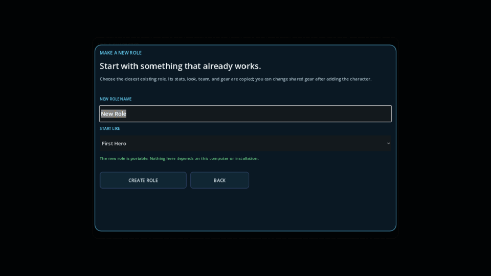
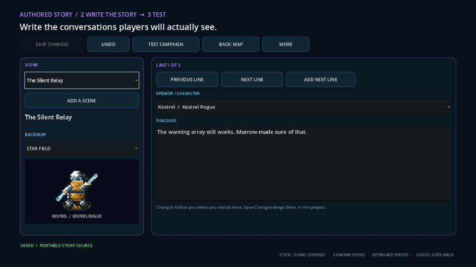

# Creating a game

Start with one small battle, play it, then grow it into a campaign. The same
creator works on PC and Android. This is a short tour of the current editor;
a full tutorial will follow as the editor settles before 1.0.

## Meet your heroes first

Open **Create / Edit Games**, start a new campaign and give it a name. The
**Battle Guide** puts the first steps together: heroes, map, forces, goal and
play. Its summaries come from your saved project, so you can leave and return
without losing your place.

Choose **Create Hero** to give a playable character a name, appearance, role
and starting weapon. Start from a working role and tune it afterwards.
**Edit Heroes** returns to the main roster. A custom role name keeps its
chosen artwork.

Named heroes persist through the campaign. In **Weapons & Defeat**, choose
which weapon families each hero can use. A hero can have several affinities:
for example, sword and focus, even while taking a Mage role. Personal
weapon choices stay with that hero when their role changes. Choose a personal
starting kit independently; the first selected weapon starts in hand. Leaving
the personal kit empty starts the hero unarmed. Turn off a personal override
to use the existing role behavior.

The weapon summary shows what starts in hand and what else the hero carries.
If a starting weapon needs an affinity the hero lacks, the form names both
and explains what to change. Apply becomes available when the choices agree.
Creation and editing errors appear inside the open form, including on phones.

**If defeated** controls what happens when that hero falls:

- **Follow the game rule** follows the campaign's default.
- **Permanent death** removes the hero from later battles.
- **Withdraw and return** lets the hero fight again in a later battle.
- **Lose this battle and withdraw** makes this a required hero: their defeat
  loses the battle and follows its authored defeat route. The hero can return
  for another attempt.

Affinities control weapon use. The shared store can still hold weapons that
none of the current heroes can use. **Apply** keeps the character edit; save
the project before leaving. Test the full campaign to check losses and returns
across stages. Each creator preview starts fresh and leaves installed saves
alone.

Ordinary enemies can be placed from reusable archetypes; they do not need
their own hero or class definition.

New campaigns give each archetype five pack slots. A weapon or item copy uses
one slot, including the weapon in hand; gold uses none. **Hero Choices**
can give a named hero their own pack size, which stays with them when their
role changes. Existing projects keep their old inventory behavior until you
choose **Use Personal Packs in This Campaign**. Equipment found in battle stays
on the map until a character collects it. A full pack lets you leave it or
exchange an older item. Gold goes to the campaign wallet.

## Make the first battle

Open the map from the guide. **Brush**, **Fill** and **Rectangle** paint terrain;
**Undo** makes experimentation safe. Choose a landmark such as a house,
orchard tree, bell, beacon, ruin or wall, then click or tap its top-left tile.
The whole footprint is placed in one step. **Remove** clears the complete
landmark from any of its tiles. Castle doorways also place both tiles in one
step. **Interior Visibility** covers a room using two corners and reveals
nearby floor as characters explore it.

In **More → Resize This Map**, type the width and height. New tiles use the
selected terrain. The preview shows what a smaller map would cut off,
including starting positions in the 2P formation.

Use **Place Heroes and Extras** to choose a named ally or an enemy archetype,
then choose its starting tile. Heroes who join later are listed with their
join stage; a placement appears in the full campaign only after that hero
has joined. Switch the **1P** and **2P** tabs above the map to compare and edit
each formation in the same view. Moving a unit in 2P keeps its 1P position.
If a 2P test needs an ally for the second player, use **Assign Player 2** in
the Battle Guide to open the correct formation. In **Battle Setup**, use
**2P-Only Units** to make a Player 2 ally or an enemy appear only in co-op.
Battle Setup also has reinforcements and patrol routes. For a repeating
wave, enter the first arrival round, the interval and the total number of
waves. The preview shows the schedule before you apply it.
**Pack & Drops**, beside an enemy archetype, sets its pack size and the gold,
weapon or item it leaves when defeated. The preview shows exact chances, and
the settings apply to every enemy using that archetype, including reinforcements.
Acquired equipment belongs to the character who obtains it. A full pack offers
a choice to leave equipment or exchange a carried copy; nothing is sent
automatically to shared supplies. During a test, select a hero again to open
their actions, then choose **Pack / Pick up**. Move onto dropped equipment to
collect it. After victory, **Continue** shows how many copies you would leave
behind; choose it when you have finished collecting.
When a hero can use several carried weapons, their actions list an attack for
each weapon by name. Choose one to see its targets and damage. Both weapons
stay in the pack; the choice applies to that attack.
**Edit Objective** explains the actual win or loss rule. Choose **This Battle**,
**Reuse**, or **Create**. A target goal starts with a suitable enemy or ally.
For a survival goal, type how many rounds to hold. Multiple goals can end the
battle independently. To revise a rule after a test, open **This Battle**,
select the goal and choose **Edit Goal**. **Apply to This Battle** keeps the
original rule in any other battle where you reused it.
Then use **Test 1 Player** or **Test 2 Players** from
the guide. The player returns to the same editing workflow afterwards.
The map editor's **Test** also starts the selected battle directly and returns
to the same map. If several battles share that map, choose the battle first.

A direct battle test starts from the authored roster and does not change your
installed game's saves. Test the whole campaign when you need to check earlier
choices, upgrades, recruitment or losses.

## Grow the adventure

Once the first battle works, use **Add Next Battle**. Each stage can have its
own map, opponents, objectives, reinforcements and 1P/2P setup. If the current
battle has several outcomes, use **Continue On** to choose which route leads
through the new stage.

Use **Shop before battle** for an optional stop before a battle. Choose goods, gold prices
and stock limits; purchases go into the selected hero’s pack and respect its
size. In co-op, both players can shop for their own heroes, using shared gold
and stock. Each marks themselves ready before the battle starts. Leave the
shop disabled to go straight into play.

Story scenes are optional. Add an opening, conversations or an ending when
they help explain what happens. **Write Story** follows the selected battle;
choose a scene when several lead into it, or create one where none exists.
You can also attach an existing scene without changing the campaign's routes.

### Give a conversation a choice

In **Map & Battle → Battle Setup**, use **Talk & Story Choices** to select
someone on the map. Open **Questions & Answers** and write the first
question. Each answer can end the conversation or open a follow-up question.

### Hide something on the map

In **Map & Battle → Battle Setup → Hidden Items**, select a tile and choose a
weapon or item from **Gear**. Leave the glint on to give players an occasional
hint. An ally has to finish a move on the tile to make the discovery. If their
pack is full, the item stays on that tile for them to pick up or exchange.
Use **Move to Another Tile** to relocate a find and keep its routes intact.

### Plan a detour

Choose **New Event Detour** below the battle in **Campaign Outline**. Select
a final reply or hidden-item discovery, then choose where the stories meet
under **After the detour**. Choose **New Ending** to give the detour its own
closing dialogue. To go straight to an existing stage, use the event as a
condition in the battle's **Outcomes**. Discovery counts even if the player
leaves the item behind.

The outline shows each event beside its detour and where it rejoins or ends.
Select that summary to edit the route. Use **Play Adventure** in the Godot
player to try both the main path and the detour. Hidden discoveries and
conversation choices work in Godot, Nintendo 64 and PlayStation exports.
On consoles, use the D-pad to choose a reply. Confirm to read more of a long
question or reply. Leaving the conversation before its final answer keeps
the unit's turn available.

Named speakers and battlefield moments can
reuse your characters. **Translations** lets you translate the game's copy
and names, including questions and answers, directly or through
gettext-compatible PO files. Pending text is
saved when moving between entries; **Discard Text Changes** restores the
last saved wording.

Use **Play Adventure 1P/2P** in the guide to start from the opening scene and
check your story, new companions, and stage transitions together. **Test 1P/2P**
still starts only the selected battle. Both return to the same stage in the
guide and keep installed-game saves separate.

## Share a playable game

Use **Finish & Export** for an editable `.grandleon.zip`, a portable campaign
bundle, a standalone PC game, or console builds when the optional builders
are installed. On Android, export the editable project or portable campaign;
open the project on a PC to build an N64 ROM or PS1 disc.

Console exports report their resource limits. The editor also shows fielded
units and N64 map cells used; a console limit does not stop PC editing or play.
The PS1 disc has no Sony licence sector and needs a compatible test setup.
See [Setting up](SETUP.md) for builders and the [project README](../README.md)
for downloadable campaign packages.

## Keep projects safe

Export editable backups at useful milestones and keep copies outside the
application's project library. When an older project needs an update, opening
or importing it explains the changes before you choose **Update and continue**.
Cancel leaves it untouched; updating keeps an exact recovery copy. The 1.5
update preserves existing heroes and choices without adding new defaults. Keep a campaign's identity stable when publishing an
update; change its **Content Revision** when an update needs a fresh save.

> We still plan to do heavy work on the editor throughout the next releases,
> and we will update the schema version with those changes. Existing projects
> should import through the migration path, but until the editor reaches a
> stable format they may need occasional adjustments. Back up your game at
> multiple stages before upgrading, and report any import or migration issue
> you find.
