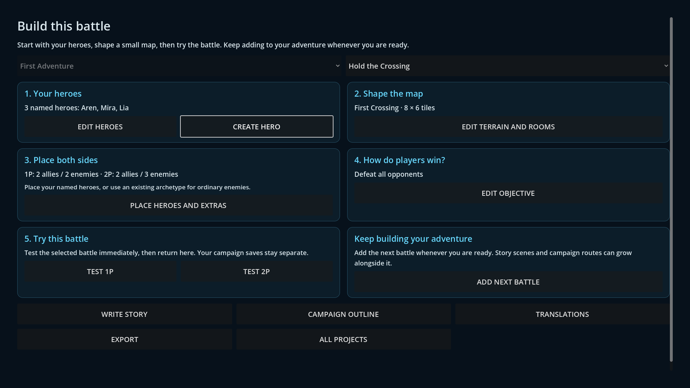
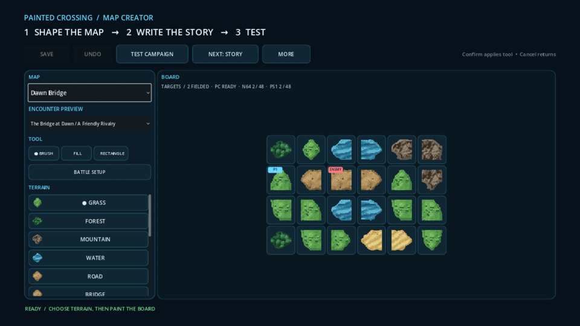
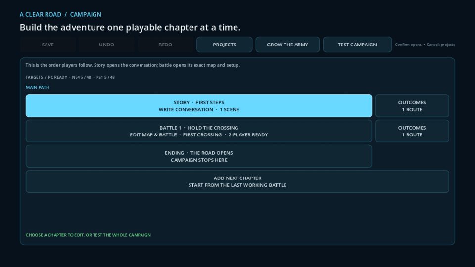
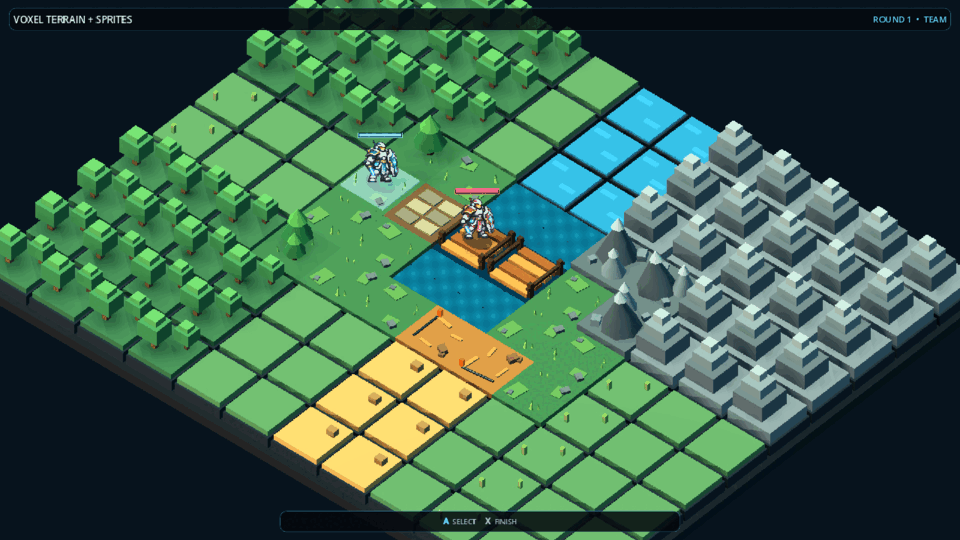

# Creating a game

Start with one small battle, play it, then grow it into a campaign. The same
creator works on PC and Android. This is a short tour of the current editor;
a full tutorial will follow as the editor settles before 1.0.

## Meet your heroes first

Open **Create / Edit Games**, start a new campaign and give it a name. The
**Battle Guide** puts the first steps together: heroes, map, forces, goal and
play. Its summaries come from your saved project, so you can leave and return
without losing your place.

Choose **Create Hero** to give a playable character a name, appearance, role
and starting weapon. Start from a working role and tune it afterwards.
**Edit Heroes** returns to the main roster. A custom role name keeps its
chosen artwork.

Named heroes persist through the campaign. In **Weapons & Defeat**, choose
which weapon families each hero can use. A hero can have several affinities:
for example, sword and focus, even while taking a Mage role. Personal
weapon choices stay with that hero when their role changes. Choose a personal
starting kit independently; the first selected weapon starts in hand. Leaving
the personal kit empty starts the hero unarmed. Turn off a personal override
to use the existing role behavior.

The weapon summary shows what starts in hand and what else the hero carries.
If a starting weapon needs an affinity the hero lacks, the form names both
and explains what to change. Apply becomes available when the choices agree.
Creation and editing errors appear inside the open form, including on phones.

**If defeated** controls what happens when that hero falls:

- **Follow the game rule** follows the campaign's default.
- **Permanent death** removes the hero from later battles.
- **Withdraw and return** lets the hero fight again in a later battle.
- **Lose this battle and withdraw** makes this a required hero: their defeat
  loses the battle and follows its authored defeat route. The hero can return
  for another attempt.

Affinities control weapon use. The shared store can still hold weapons that
none of the current heroes can use. **Apply** keeps the character edit; save
the project before leaving. Test the full campaign to check losses and returns
across stages. Each creator preview starts fresh and leaves installed saves
alone.

Ordinary enemies can be placed from reusable archetypes; they do not need
their own hero or class definition.

## Make the first battle

Open the map from the guide. **Brush**, **Fill** and **Rectangle** paint terrain;
**Undo** makes experimentation safe. Landmarks place complete houses, trees
and other features together. Castle doorways place a complete two-cell arch
with one click or tap. **Interior Visibility** can cover a room using two
corners, then reveal nearby floor as characters explore it.

Use **Place Heroes and Extras** to choose a named ally or an enemy archetype,
then choose its starting tile. Under **Battle Setup**, you can also arrange
reinforcements, patrols and the differences between solo and co-op forces.
Choose the battle's goal, then use **Test 1 Player** or **Test 2 Players** from
the guide. The player returns to the same editing workflow afterwards.

A direct battle test starts from the authored roster and does not change your
installed game's saves. Test the whole campaign when you need to check earlier
choices, upgrades, recruitment or losses.

## Grow the adventure

Once the first battle works, use **Add Next Battle**. Each stage can have its
own map, opponents, objectives, reinforcements and solo/co-op setup. The
campaign outline connects those stages; advanced branching remains available
when you need it.

Story scenes are optional. Add an opening, conversations or an ending when
they help explain what happens. Named speakers and battlefield moments can
reuse your characters. **Translations** lets you translate the game's copy
and names, directly or through gettext-compatible PO files. Pending text is
saved when moving between entries; **Discard Text Changes** restores the
last saved wording.

## Share a playable game

Use **Finish & Export** for an editable `.grandleon.zip`, a portable campaign
bundle, a standalone PC game, or console builds when the optional builders
are installed. On Android, export the editable project or portable campaign;
open the project on a PC to build an N64 ROM or PS1 disc.

Console exports report their resource limits. The editor also shows fielded
units and N64 map cells used; a console limit does not stop PC editing or play.
The PS1 disc has no Sony licence sector and needs a compatible test setup.
See [Setting up](SETUP.md) for builders and the [project README](../README.md)
for downloadable campaign packages.

## Keep projects safe

Export editable backups at useful milestones and keep copies outside the
application's project library. Import warnings explain schema updates and
preserve recovery data. Keep a campaign's identity stable when publishing an
update; change its **Content Revision** when an update needs a fresh save.

> We still plan to do heavy work on the editor throughout the next releases,
> and we will update the schema version with those changes. Existing projects
> should import through the migration path, but until the editor reaches a
> stable format they may need occasional adjustments. Back up your game at
> multiple stages before upgrading, and report any import or migration issue
> you find.
